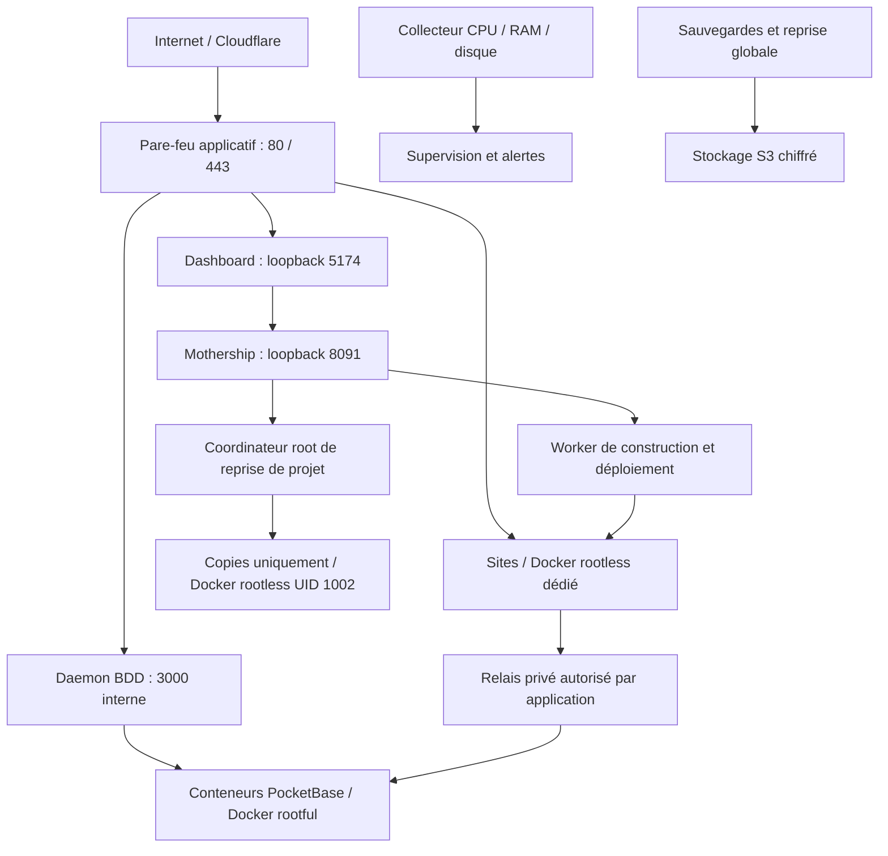

# Créer un nouveau serveur Kolab

Procédure opérateur pour un serveur regroupant **PocketBase, hébergement web, accès privé aux BDD, sauvegardes et supervision**.

L'allocation de RAM automatique fait partie de la réception d'un nouvel hôte. Après initialisation du contrôleur, du worker et du moteur rootless dédié, exécuter depuis le répertoire de la version :

```sh
sudo python3 packages/pockethost/scripts/install-memory-allocation.py
sudo systemctl is-active pockethost-memory-allocation
sudo cat /var/lib/kolab-memory-allocation/status.json
```

Vérifier le contrôle « Allocation automatique de RAM » dans la supervision. L'installateur conserve la configuration locale existante ; la politique, les exceptions aux quotas explicites et le retour arrière sans arrêt des sites sont décrits dans [WEB_RESOURCE_ALLOCATION.md](../../WEB_RESOURCE_ALLOCATION.md). Ne pas copier l'état mémoire d'un autre serveur.

L’installateur active aussi `pockethost-platform-operator.socket` pour les réglages manuels de RAM et la pause/reprise des nouvelles opérations. Le contrôleur utilise ce socket local sous `NoNewPrivileges`, sans lancer `sudo`. Vérifier ces actions avec le vrai TOTP et un contrôleur jetable protégé, en suivant [la réception des contrôles d’administration](operator-controls.md). Les essais d’écriture utilisent exclusivement un conteneur et des politiques jetables.

Vérifier également la présence du module installé `database_memory_reservations.py`, la fraîcheur du bilan `/run/kolab-memory-allocation/reservations.json` et la lecture de la politique publique par le daemon et le worker. Les bases natives partent d'un plafond de 4 Gio, conservent leurs limites apprises après recréation et ne réduisent plus leur plafond pendant l'inactivité. Une base nécessitant un montant dédié utilise la politique locale root `/etc/kolab/database-memory-reservations.json` ; conserver sa capacité dans les budgets et la reprise de cet hôte. Sauvegarder aussi `database-history.json`. Tester ces chemins et permissions avant de déclarer le nouveau serveur prêt.

Référence : installations d’app4 et d’app5 et correctifs vérifiés jusqu’au **1er novembre 2026**, dont l’installation de `cpulimit`, la validation Cloudflare avant activation du proxy et le respect du dossier de construction des workers et Dockerfiles. Le code de référence comprend le commit `5f9044ec35c8e5e98d9b999d7bf97d620e266588` ; choisir ensuite une release validée plus récente si nécessaire.

Ce document sert à préparer et à réceptionner une installation. **Ce n’est pas un script à exécuter intégralement.** Les commandes sont repérées par contexte ; les valeurs entre `<...>` sont à remplacer. Conserver une copie remplie de la fiche serveur dans le dossier opérateur privé, avec les preuves de recette, sans y recopier les secrets.

## Sommaire

- [Fiche serveur](#1-fiche-du-nouveau-serveur) et [architecture](#2-architecture-à-conserver).
- [Machine, SSH et paquets](#3-préparer-la-machine-et-les-accès), puis [Docker](#4-installer-et-cloisonner-docker).
- [Release et runtime](#5-runtime-node-et-release-applicative), [secrets et environnements](#6-secrets-environnements-et-permissions).
- [DNS, Cloudflare et certificats](#7-dns-cloudflare-et-certificats), [démarrage de la plateforme](#8-démarrage-et-persistance-de-la-plateforme).
- [Hébergement](#9-hébergement-builder-et-stockage), [accès privé BDD](#10-accès-privé-aux-bases), [GitHub](#11-git-github-et-déploiements-automatiques).
- [Sauvegardes et reprise](#12-sauvegardes-restaurations-et-reprise-globale), [supervision et alertes](#13-supervision-complète-et-alertes).
- [Moteur de recette isolé](#44-moteur-rootless-distinct-pour-les-copies-de-reprise) et [coordinateur de reprise de projet](#125-reprise-isolée-dun-projet).
- [Recette fonctionnelle](#14-recette-fonctionnelle-avant-ouverture), [commandes de contrôle](#15-commandes-de-vérification-utiles), [reboot](#16-reboot-obligatoire-avant-réception).
- [Migration et retour arrière](#17-migration-publication-et-retour-arrière), [erreurs connues](#18-erreurs-connues-à-diagnostiquer-rapidement).
- [Checklist finale](#19-checklist-de-réception-finale), [compte rendu](#20-compte-rendu-à-conserver) et [références](#21-références-du-dépôt).

## 1. Fiche du nouveau serveur

Remplir cette fiche avant toute installation. `appN` désigne le nouvel identifiant ; ne pas recopier `app3`, `app4`, leurs IP, leurs identifiants internes ou leurs chemins datés.

| Élément                                            | Valeur à renseigner                                                 |
| -------------------------------------------------- | ------------------------------------------------------------------------------ |
| Identifiant unique                                 | `<appN>`                                                            |
| IPv4 publique, IPv6 éventuelle                     | `<IPV4>` / `<IPV6 ou aucune>`                                       |
| Nom du dashboard et suffixe des nouveaux sites     | `<appN>.monappli.re`                                                |
| Compte opérateur                                   | `ubuntu`, UID/GID `1000:1000` pour les outils actuels               |
| Compte hébergement                                 | `pockethost-web`, UID/GID `1001:1001` pour les outils actuels       |
| Compte de recette isolée                           | `kolab-recovery`, UID/GID `1002:1002`, home privée, sans connexion interactive |
| OS, architecture, noyau                            | `<versions vérifiées>` ; profil de référence Linux amd64, cgroup v2 |
| CPU, RAM, disques, montage des données             | `<inventaire réel>`                                                 |
| Release et commit                                  | `/home/ubuntu/pockethost-releases/<appN>-<date>` / `<SHA Git>`      |
| Home PocketHost                                    | `/home/ubuntu/.local/share/pockethost`                              |
| Données du contrôleur et des BDD                   | `/home/ubuntu/.local/share/pockethost/data`                         |
| Données hébergement                                | `/home/pockethost-web/data`                                         |
| Configuration opérateur                            | `/etc/kolab/<appN>`                                                 |
| Zone et compte Cloudflare                          | `<identifiants, sans jeton>`                                        |
| Contact certificats, SMTP, destinataires d’alertes | `<coordonnées et noms des entrées du coffre>`                       |
| Bucket/région/préfixes de sauvegarde               | `<références, sans clés>`                                           |
| Emplacement externe des clés de déchiffrement      | `<référence au coffre>`                                             |
| Cas de départ                                      | serveur neuf / migration / reprise après sinistre                   |
| Retour arrière                                     | `<ancien serveur ou dernière release, responsable, délai>`          |

Sur le **poste opérateur**, on peut utiliser ces variables non secrètes :

```bash
export KOLAB_ID='appN'
export KOLAB_FQDN="${KOLAB_ID}.monappli.re"
export KOLAB_PUBLIC_IP='<IPV4_PUBLIQUE>'
export KOLAB_RELEASE="/home/ubuntu/pockethost-releases/${KOLAB_ID}-<AAAAMMJJ>"
```

Ces variables ne sont pas automatiquement transmises à une session SSH, à `sudo`, à systemd ou aux fichiers `.env`. Les définir aussi dans le contexte où une commande en a besoin, ou remplacer explicitement leurs valeurs. Les fichiers `.env` présentés plus bas utilisent des **valeurs littérales**.

## 2. Architecture à conserver



| Composant                                         | Identité / accès attendu                                                                                |
| ------------------------------------------------- | ------------------------------------------------------------------------------------------------------- |
| Contrôleur, firewall, dashboard, daemon, FTP/SFTP | services de confiance sous `ubuntu`                                                                     |
| Docker des BDD                                    | moteur rootful, socket `/run/docker.sock`                                                               |
| Worker et Docker hébergement                      | `pockethost-web`, socket `/run/user/1001/docker.sock`                                                   |
| Applications hébergées                            | UID `10001`, quotas, racine en lecture seule, aucune capacité, aucun socket Docker                      |
| Builder BuildKit                                  | réseau distinct des sites, quotas explicites, image vérifiée                                            |
| Accès privé BDD                                   | autorisation par application, auxiliaires et sockets dédiés ; aucun bridge commun à tous les locataires |
| Collecteur de ressources                          | service root restreint, lectures locales, caches filtrés pour le contrôleur                             |
| Coordinateur de reprise de projet                 | nouveau service root restreint, sources sélectionnées, clés propres à l’hôte                            |
| Docker des copies de recette                      | `kolab-recovery`, socket privé `/run/user/1002/docker.sock`, inaccessible à UID 1001                     |

L’accès au groupe `docker` du moteur rootful confère des pouvoirs très élevés sur l’hôte. Il est réservé aux composants de confiance. Le worker web et les locataires ne doivent pas obtenir cet accès.

### Ordre de travail

1. Identité du serveur, SSH et accès de secours.
2. OS, paquets, firewall réseau et Docker.
3. Release, binaires, secrets, DNS et TLS de la plateforme.
4. Contrôleur et dashboard seuls, puis services des BDD.
5. Docker rootless, worker, construction et stockage web.
6. Relais privé, GitHub, domaines personnalisés, sauvegardes et supervision.
7. Recette complète, redémarrage du serveur, puis ouverture aux utilisateurs ou bascule DNS.

En migration, la bascule DNS et le démarrage des données importées arrivent seulement après le gel des écritures, la copie finale et les contrôles. Voir [la reprise et les migrations](../../WEB_RECOVERY_RUNBOOK.md).

## 3. Préparer la machine et les accès

### 3.1 Inventaire et capacité

Sur le **nouveau serveur** :

```bash
cat /etc/os-release
uname -m
nproc
free -h
lsblk -f
df -hT
df -i
stat -fc %T /sys/fs/cgroup
timedatectl status
```

Attendus : architecture compatible avec les binaires/images retenus ; `cgroup2fs` ; disques et inodes disponibles ; synchronisation de l’heure active. Conserver le fuseau système choisi dans la fiche ; vérifier séparément le fuseau des planifications du dashboard.

Budgéter **BDD + sites + builder + plateforme + sauvegardes + marge**. En mode fixe, additionner les plafonds. En [mode adaptatif](../../WEB_RESOURCE_ALLOCATION.md), conserver un plafond global, une demande mémoire par application et une marge ; le worker contrôle les engagements et la disponibilité réelle avant chaque démarrage, y compris lors de la coexistence de deux versions.

Profil app4 après ajustement du 1er novembre 2026 : parent hébergement 9 CPU / 16 Gio sur un hôte à 12 CPU logiques, builder 4 CPU / 8 Gio. L’ancien plafond de 8 CPU refusait un build dès que les sites et auxiliaires réservaient 4,1 CPU : `4,1 + 4 = 8,1`, même avec de la RAM disponible. Compter aussi les auxiliaires, et vérifier CPU et mémoire séparément. Ce sont des plafonds d’un profil existant, pas des valeurs à appliquer à tout nouvel hôte. Le builder n’obtient pas 8 Gio supplémentaires en dehors des 16 Gio du parent.

Prévoir au moins la garde de **15 Gio libres** requise par les outils web/reprise, plus les copies temporaires, images, volumes et données à restaurer. Vérifier aussi le disque hébergeant Docker et celui des sauvegardes.

### 3.2 Clés SSH et accès de secours

- [ ] Console de secours du fournisseur disponible.
- [ ] Empreinte SSH de l’hôte vérifiée.
- [ ] Clés publiques de tous les postes opérateur autorisées.
- [ ] Clés privées conservées sur les postes/coffre, jamais copiées sur le serveur.
- [ ] Connexion par clé testée dans une **deuxième session** avant de désactiver les mots de passe.

Depuis le **poste opérateur**, lorsque l’accès initial le permet :

```bash
ssh-copy-id -i ~/.ssh/id_ed25519.pub "ubuntu@${KOLAB_PUBLIC_IP}"
ssh -o BatchMode=yes -o PreferredAuthentications=publickey "ubuntu@${KOLAB_PUBLIC_IP}" 'id'
```

`ssh-copy-id` n’est pas présent sur tous les postes : l’ajout de la clé publique via le fournisseur ou `authorized_keys` convient aussi. Vérifier `~/.ssh` en `0700` et `authorized_keys` en `0600`, appartenant à `ubuntu`.

### 3.3 Paquets système, dont cpulimit

Installer les prérequis **avant** de lancer une sauvegarde ou une restauration :

```bash
sudo bash packages/pockethost/scripts/install-server-prerequisites.sh
```

Revoir les mises à jour et effectuer les redémarrages système nécessaires avant la recette finale. `NEEDRESTART_MODE=l` limite les redémarrages automatiques pendant cette installation ; il ne dispense pas de traiter les services ou le noyau à mettre à jour.

Contrôles :

```bash
for outil in cpulimit tar gzip nice ionice sqlite3 python3 git ssh ssh-keygen ssh-keyscan certbot; do
  command -v "$outil" || exit 1
done
python3 -c 'import boto3, cryptography'
dpkg-query -W cpulimit
```

**Incident à ne pas reproduire :** avec `INSTANCE_BACKUP_CPU_LIMIT_PERCENT=50`, l’absence de `cpulimit` fait échouer la sauvegarde de sécurité préalable à une restauration. La restauration peut déjà avoir arrêté la BDD à ce stade. Ne pas supprimer la limite CPU pour contourner le problème : installer le paquet et exécuter le test du §15.2.

La présence du module Python `sqlite3` ne remplace pas le **programme `sqlite3`** : les imports externes l’exécutent pour préserver les réglages de la BDD cible. Tester les deux. Les sauvegardes BDD R2/S3 gérées par le contrôleur utilisent aussi le CLI `aws` ; si cette fonction est activée, installer une AWS CLI compatible, vérifier `aws --version` sous l’identité du contrôleur et tester sa connexion. Les bibliothèques `boto3` employées par les sauvegardes web/reprise ne remplacent pas ce CLI.

### 3.4 SSH par clé et fail2ban

Après validation de la deuxième session, installer un fichier de configuration SSH adapté, par exemple `/etc/ssh/sshd_config.d/00-kolab-hardening.conf` :

```text
PubkeyAuthentication yes
PasswordAuthentication no
KbdInteractiveAuthentication no
PermitRootLogin no
```

Vérifier la configuration **effective**, y compris les fichiers cloud-init et éventuels blocs `Match` :

```bash
sudo sshd -t
sudo sshd -T | grep -E '^(pubkeyauthentication|passwordauthentication|kbdinteractiveauthentication|permitrootlogin) '
sudo systemctl reload ssh
```

Retester immédiatement une nouvelle connexion par clé. Pour un compte soumis à `Match`, utiliser aussi `sshd -T -C` avec son utilisateur, son hôte et son adresse client. Une configuration d’authentification multifacteur nécessite un profil SSH adapté ; ne pas lui appliquer aveuglément cet exemple. [Documentation OpenSSH Ubuntu](https://ubuntu.com/server/docs/how-to/security/openssh-server/).

Configurer `/etc/fail2ban/jail.d/kolab-sshd.local` :

```ini
[sshd]
enabled = true
backend = systemd
maxretry = 5
findtime = 10m
bantime = 1h
```

```bash
sudo systemctl enable --now fail2ban
sudo fail2ban-client status sshd
sudo visudo -c
sudo -l -U ubuntu
```

Revoir les sudoers du fournisseur et les wrappers nécessaires. Ne pas ajouter un nouveau `NOPASSWD:ALL` comme étape standard ; documenter les droits effectivement requis et leurs bénéficiaires.

### 3.5 Ports et firewall réseau

| Port entrant                                         | Politique                                                        |
| ---------------------------------------------------- | ---------------------------------------------------------------- |
| SSH hôte `22/tcp`                                    | opérateurs ; restriction IP/VPN si utilisable sans perte d’accès |
| `80/tcp`, `443/tcp`                                  | publics, HTTP/HTTPS et challenges ACME                           |
| SFTP applicatif `2222/tcp`                           | seulement si le service est activé et testé                      |
| FTP `21/tcp` et plage passive                        | seulement si le besoin FTPS est confirmé ; tester le client réel |
| `3000`, `5174`, `8090`, `8091`, ports Docker `3xxxx` | jamais ouverts comme accès publics directs                       |
| Docker TCP `2375/2376`                               | aucun listener de gestion public                                 |

Sur un hôte neuf, ouvrir SSH **avant** d’activer UFW :

```bash
sudo ufw default deny incoming
sudo ufw default allow outgoing
sudo ufw allow 22/tcp
sudo ufw allow 80/tcp
sudo ufw allow 443/tcp
sudo ufw enable
sudo ufw status verbose
```

Appliquer aussi la politique au firewall du fournisseur et à IPv6 si elle est active. Les sorties doivent permettre DNS, NTP, HTTPS, registres d’images/paquets, Git et SMTP selon les services choisis.

## 4. Installer et cloisonner Docker

### 4.1 Moteur rootful des BDD

Suivre [l’installation officielle Docker pour Ubuntu](https://docs.docker.com/engine/install/ubuntu/) pour le dépôt signé correspondant à l’OS. Consigner les versions de `docker-ce`, `docker-ce-cli`, `containerd.io`, Buildx, Compose et `docker-ce-rootless-extras`. Installer un ensemble compatible, puis vérifier :

```bash
sudo docker version
sudo docker info
sudo docker buildx version
sudo docker compose version
command -v dockerd-rootless-setuptool.sh rootlesskit newuidmap newgidmap
```

Dans `/etc/docker/daemon.json`, intégrer les valeurs suivantes en **préservant les autres réglages** :

```json
{
  "ip": "127.0.0.1",
  "log-driver": "json-file",
  "log-opts": { "max-size": "10m", "max-file": "3" }
}
```

Valider le JSON et la configuration Docker. Sur le **serveur neuf, avant les locataires**, appliquer la configuration et contrôler les publications créées ensuite. Modifier `ip` ne corrige pas les publications de conteneurs déjà existants : leur recréation demande une opération distincte.

### 4.2 Protection persistante des publications Docker

UFW seul ne suffit pas à filtrer les ports publiés par Docker : le chemin des paquets Docker peut contourner ses règles d’entrée. [Explication Docker/UFW](https://docs.docker.com/engine/network/packet-filtering-firewalls/).

Le dépôt fournit [docker-ingress-guard.py](../../packages/pockethost/scripts/docker-ingress-guard.py). Sur un hôte applicatif utilisant le backend Docker **iptables**, l’installer sous un chemin root, non modifiable par les services, puis l’appeler par un `ExecStartPost` de `docker.service` pour le réappliquer au démarrage. Exemple d’emplacements :

```text
/usr/local/sbin/kolab-docker-ingress-guard.py
/etc/systemd/system/docker.service.d/kolab-ingress.conf
```

Contenu du drop-in :

```ini
[Service]
ExecStartPost=/usr/bin/python3 /usr/local/sbin/kolab-docker-ingress-guard.py
```

Avant activation, vérifier `DOCKER-USER` dans **iptables et ip6tables**, les interfaces publiques détectées et l’absence de rôle routeur sur l’hôte. L’outil attend ces chaînes et refuse si elles manquent. Un backend Docker nftables natif exige une politique adaptée ; ne pas considérer ce script iptables comme compatible par défaut. [Règles Docker et chaîne DOCKER-USER](https://docs.docker.com/engine/network/firewall-iptables/).

- [ ] Garde exécutée sans erreur en IPv4 et IPv6.
- [ ] Chaîne `KOLAB-DOCKER-IN` présente avant les acceptations Docker.
- [ ] Un conteneur publié volontairement sur une IP publique de test reste inaccessible depuis l’extérieur.
- [ ] Les connexions sortantes des conteneurs restent fonctionnelles.
- [ ] Les mêmes contrôles passent après redémarrage de Docker et, avant ouverture aux clients, après reboot de l’hôte.

La validation extérieure est indispensable ; une sortie UFW correcte n’est pas cette preuve.

### 4.3 Moteur rootless pour l’hébergement

Vérifier les UID avant création des comptes. L’installateur du relais privé actuel attend exactement `ubuntu=1000:1000` et `pockethost-web=1001:1001` ; un autre profil exige l’adaptation et la validation des outils, pas une renumérotation de comptes ayant déjà des données.

Le script [setup-web-hosting.sh](../../packages/pockethost/scripts/setup-web-hosting.sh) prépare le compte web, les plages subuid/subgid, le moteur rootless, la délégation cgroup et les unités worker/terminal. Relire ses valeurs avant usage :

```bash
sudo env WEB_APPS_MEMORY_MAX='<BUDGET_GIO>G' \
  WEB_APPS_CPU_QUOTA='<BUDGET_CPU_EN_POURCENT>%' \
  WEB_NODE_BINARY='<CHEMIN_ABSOLU_NODE_24>' \
  bash packages/pockethost/scripts/setup-web-hosting.sh
```

Ce script exige les budgets CPU et mémoire explicites : `900%` représente 9 CPU. Il exige le profil actuel `ubuntu=1000:1000`, `pockethost-web=1001:1001` et refuse toute collision d’identités sans renumérotation automatique. Il refuse un budget supérieur à la capacité physique (au moins 1 Gio réservé hors hébergement), Node <24 et la reconfiguration d’un worker ou terminal actif. Il installe les prérequis communs, sans réinstaller de force un moteur rootless existant. Les unités worker et terminal restent à activer après configuration. En mode fixe, additionner **builder + sites + auxiliaires + réserve**. En mode adaptatif, le contrôle de réception vérifie les demandes et la marge ; le worker vérifie la capacité réelle à chaque admission. Pour modifier un hôte actif, suivre une procédure de maintenance avec vérification des limites effectives.

Contrôles sous l’identité web :

```bash
sudo loginctl show-user pockethost-web -p Linger
sudo systemctl show user-1001.slice -p CPUQuotaPerSecUSec -p MemoryMax -p MemorySwapMax -p TasksMax
sudo runuser -u pockethost-web -- env XDG_RUNTIME_DIR=/run/user/1001 \
  DOCKER_HOST=unix:///run/user/1001/docker.sock \
  docker info --format '{{json .SecurityOptions}} {{.CgroupVersion}} {{.CgroupDriver}}'
```

Attendus : rootless, cgroup v2, pilote systemd, plages subuid/subgid non chevauchantes, linger actif, quotas réellement appliqués. Contrôler également `--disable-host-loopback` dans le démarrage RootlessKit et l’impossibilité pour un site de joindre les services loopback de l’hôte. Voir [les prérequis rootless Docker](https://docs.docker.com/engine/security/rootless/).

Fixer aussi `MemorySwapMax` et `TasksMax` selon le profil retenu ; le profil app4 emploie respectivement `0` et `2048`. Sur Ubuntu, un refus de namespace utilisateur demande de vérifier les prérequis et profils AppArmor de Docker rootless, sans désactiver globalement AppArmor pour contourner le problème.

### 4.4 Moteur rootless distinct pour les copies de reprise

Cette préparation concerne le lot reprise/migration décrit dans [le suivi de livraison](productivity-rollout.md). Vérifier sa réception avant de le proposer aux utilisateurs ; la présence de ces instructions ne signifie pas qu’il est déjà publié sur les trois serveurs.

Les copies de bases doivent être séparées du moteur d’hébergement UID 1001. Le compte `kolab-recovery` est UID/GID 1002, avec `/home/kolab-recovery` et `/run/user/1002` en mode 0700. Son socket `/run/user/1002/docker.sock` appartient à UID 1002 ; le worker UID 1001 ne doit pouvoir ni l’ouvrir ni lire les copies. Ne pas réutiliser le socket 1001 pour une recette, changer les propriétaires des données sources ou renuméroter un compte existant.

Depuis la release cohérente, avec l’image auxiliaire approuvée **par ID SHA256 exact**, préparer puis exécuter :

```bash
sudo python3 packages/pockethost/scripts/install-project-recovery-engine.py \
  --helper-image 'sha256:<ID_APPROUVE>'
sudo python3 packages/pockethost/scripts/install-project-recovery-engine.py \
  --helper-image 'sha256:<ID_APPROUVE>' --execute
sudo python3 packages/pockethost/scripts/install-project-recovery-engine.py \
  --helper-image 'sha256:<ID_APPROUVE>' --verify-only
```

L’installateur refuse les collisions d’identité/home et les plages subuid/subgid chevauchantes ; il conserve les plages déjà attribuées. Il crée seulement ce nouveau moteur, exporte l’outillage approuvé depuis UID 1001 et en vérifie l’identité dans le moteur 1002. Il ne redémarre ni le Docker des BDD, ni le moteur 1001, ni PM2. Les prérequis rootless et cgroupv2 doivent déjà fonctionner.

Contrôler la **slice entière** `user-1002.slice` : `MemoryHigh=3G`, `MemoryMax=4G`, `MemorySwapMax=0`, `CPUQuota=100%`, `TasksMax=512`. Les 100 % correspondent à un cœur. Ces limites sont indépendantes du budget web 1001 ; elles couvrent aussi les scopes des conteneurs de recette. L’admission doit conserver la réserve hôte de 15 % / 2 Gio minimum, les engagements BDD, une pointe de 4 Gio pour le moteur 1002 et 1 Gio pour le coordinateur. Prévoir aussi 15 Gio libres au-delà des artefacts, vérifiés pendant les copies. Un manque de capacité suspend la recette ; il ne justifie pas de retirer la réserve d’une base cliente.

Voir [la séparation des moteurs et ses contrôles](project-recovery.md#séparation-des-moteurs), puis installer le coordinateur au §12.5.

## 5. Runtime Node et release applicative

### 5.1 Versions et fichiers livrés

- Node.js **24**, version exacte validée et empreinte officielle vérifiée ; app4 utilise une distribution Node dédiée sous `/opt`.
- `pnpm` conforme au champ `packageManager` du dépôt (`11.6.0` dans le code de référence).
- PM2 et ses dépendances installés avec un verrou de versions ; app4 a utilisé PM2 `7.0.3`.
- Binaires PocketBase compatibles avec le contrôleur et les versions proposées aux BDD ; app4 utilise le contrôleur natif `0.39.11`.
- Images PocketBase, BuildKit et auxiliaires disponibles dans le **bon moteur Docker**.

Contrôler les exécutables utilisés par les services, pas seulement ceux du shell SSH :

```bash
node --version
pnpm --version
command -v node pnpm
```

Le lancement par systemd doit employer un chemin Node explicite. Une installation interactive via nvm ne configure pas automatiquement les services. Un `pnpm` récent lancé avec Node 20 peut échouer sur `node:sqlite` : corriger le chemin de Node, pas les dépendances applicatives au hasard.

### 5.2 Préparer une release figée

Depuis un clone de confiance, sélectionner le commit validé, installer avec le lockfile puis compiler :

```bash
git rev-parse HEAD
pnpm install --frozen-lockfile
pnpm --filter pockethost-mothership-app build
```

Avant livraison, sur la machine de validation :

```bash
VITEST_MAX_WORKERS=1 pnpm check:push
pnpm check:mothership-hooks
```

Les tests natifs complémentaires se lancent dans leurs environnements jetables documentés ; ils ne ciblent pas les BDD de production. Les bundles `mothership.js` et `mothership.pb.js`, les sources et migrations doivent correspondre au même commit. Conserver un manifeste d’empreintes de la release et des binaires.

**Ne pas lancer `setup.sh` comme installateur de production complet.** Il contient des étapes historiques : mise à jour globale, suppression de paquets Docker, sudo large et noms d’hôte d’exemple. Il ne représente pas la procédure actuelle Kolab.

### 5.3 Réserver les noms du nouveau serveur

Ajouter le nouveau nom du dashboard et les éventuels noms de contrôleur dédiés dans [platformDashboardHosts.ts](../../packages/pockethost/src/common/platformDashboardHosts.ts), puis recompiler et tester. La liste de référence contient des noms explicites jusqu’à app4.

Vérifier les redirections d’authentification, cookies, CORS, liens de console PocketBase, URL GitHub App et transferts entre serveurs. Les anciens alias d’app4 ont été ajoutés pour la migration d’app/app2 : un nouveau serveur indépendant ne doit pas les récupérer automatiquement.

## 6. Secrets, environnements et permissions

### 6.1 Inventaire des secrets

| Secret                                                                | Portée                                                                         | Conservation                                                                                    |
| --------------------------------------------------------------------- | -------------------------------------------------------------------------------------------- | ----------------------------------------------------------------------------------------------------------- |
| Identité et mot de passe superutilisateur du contrôleur               | services de confiance uniquement                                               | fichier privé + coffre                                                                          |
| `PH_SECRET`                                                           | échanges internes de la plateforme                                             | valeur propre au serveur                                                                        |
| `WEB_APPS_MASTER_KEY`                                                 | contrôleur, 32 caractères ASCII aléatoires exactement                          | sauvegarde externe indispensable pour relire les valeurs chiffrées                              |
| `WEB_APPS_WORKER_SECRET`                                              | contrôleur et worker, au moins 32 caractères                                   | même valeur aux deux extrémités                                                                 |
| `WEB_DB_BRIDGE_SECRET`                                                | contrôleur et broker, créé/conservé par l’installateur                         | ni worker, ni dashboard, ni locataires                                                          |
| `PLATFORM_MONITORING_KEY`                                             | chiffrement des réglages de supervision ; repli possible sur la clé maître web | conserver la clé réellement utilisée                                                            |
| `WEB_BACKUPS_S3_IMAGE_KEY`                                            | sauvegardes des images web, 64 caractères hexadécimaux                         | distincte de la clé de reprise globale                                                          |
| Clé de reprise globale                                                | fichier privé, 64 caractères hexadécimaux                                      | copie hors serveur et hors bucket, distincte des deux clés précédentes                          |
| `project-recovery.key` et `project-recovery-controller.key`           | chiffrement des capsules de recette et capacité locale du coordinateur, deux clés distinctes | root 0600 et root:ubuntu 0640 ; propres à l’hôte, jamais dans le worker 1001 ni transférées à un autre serveur |
| `project-migration-control.key`                                       | capacité opérateur du contrôleur local de migration                                          | root:ubuntu 0440 ; distincte des clés de reprise et du worker                                                |
| SMTP, S3, Cloudflare, GitHub, Litestream                              | composants qui en ont besoin                                                   | coffre, fichiers `0600`, aucune variable publique                                               |
| Clés d’hôte SFTP/SSH et clés TLS                                      | service concerné                                                               | sauvegarde sécurisée ; préserver l’identité en migration                                        |
| Clés de chiffrement TOTP/2FA et des réglages PocketBase, si utilisées | contrôleur et instances concernées                                             | inclure les fichiers nécessaires à la reprise et tester une authentification après restauration |

Générer de nouvelles clés pour un serveur neuf. **En migration/reprise, conserver les clés nécessaires aux données importées** : une rotation aveugle peut rendre les variables, archives ou identités illisibles. Ne pas copier les secrets d’un serveur indépendant pour simplifier l’installation.

Créer les secrets dans des fichiers privés avec `umask 077`, sans affichage dans le terminal, le chat ou les logs. `openssl rand -hex 16` produit 32 caractères pour une clé maître ; `openssl rand -hex 32` produit 64 caractères pour une clé d’archive. Rediriger vers un **nouveau** fichier privé et ne pas écraser une clé existante.

### 6.2 Fichier du contrôleur

Le runtime CLI charge **`.env`**, pas `.env.local`. Un lien `.env` vers une configuration partagée sous `/home/ubuntu` est possible : maintenir le lien et protéger sa cible canonique en `0600`, propriétaire `ubuntu`.

Extrait non secret, avec valeurs à adapter :

```dotenv
NODE_ENV=production
PH_DEBUG=false
DEBUG=false
HTTP_PROTOCOL=https:
APEX_DOMAIN=<appN>.monappli.re
APP_HOST=<appN>.monappli.re
APP_URL=https://<appN>.monappli.re
MOTHERSHIP_URL=http://127.0.0.1:8091
MOTHERSHIP_SEMVER=<VERSION_CONTROLEUR_VALIDEE>
PH_EDGE_ID=<appN>
PH_HOME=/home/ubuntu/.local/share/pockethost
DATA_ROOT=/home/ubuntu/.local/share/pockethost/data
WEB_APPS_ENABLED=true
WEB_APPS_ROOT=/home/pockethost-web/data
WEB_APPS_PUBLIC_IP=<IPV4_PUBLIQUE>
WEB_APPS_DOMAIN_HELPER=/opt/pockethost-web/web_app_domains.py
INSTANCE_BACKUP_CPU_LIMIT_PERCENT=50
INSTANCE_RESTORE_CPU_LIMIT_PERCENT=50
INSTANCE_BACKUP_GZIP_LEVEL=1
```

Compléter séparément les secrets requis, les chemins des migrations/hooks, les certificats `SSL_CERT`/`SSL_KEY`, la configuration Cloudflare et les options PocketBase. Les 50 % limitent les commandes d’archives ; ce n’est pas un pourcentage du total de tous les CPU de l’hôte.

Ne pas activer implicitement les webhooks d’instances, les transferts hérités ou les tâches de nettoyage d’un ancien serveur. Décider explicitement de `PH_DISABLE_INSTANCE_WEBHOOKS` et vérifier l’absence d’un indicateur opposé `PH_ENABLE_INSTANCE_WEBHOOKS` qui le surchargerait.

### 6.3 Worker et firewall

Le worker utilise `/home/pockethost-web/web-apps.env`, mode `0600`, propriétaire `pockethost-web` :

```dotenv
WEB_APPS_ROOT=/home/pockethost-web/data
WEB_APPS_DOCKER_SOCKET=/run/user/1001/docker.sock
WEB_APPS_CONTROL_URL=http://127.0.0.1:8091
WEB_APPS_PUBLIC_IP=<IPV4_PUBLIQUE>
WEB_APPS_CERT_EMAIL=<CONTACT_CERTIFICATS>
WEB_APPS_ALLOCATION_MODE=adaptive
WEB_APPS_BUILD_CPUS=<CPU_BUILDER>
WEB_APPS_BUILD_MEMORY=<MEMOIRE_BUILDER_EX_8g>
WEB_APPS_BUILDKIT_IMAGE=moby/buildkit@sha256:<DIGEST_VERIFIE>
WEB_APPS_STORAGE_HELPER_IMAGE=sha256:<IMAGE_AUXILIAIRE_VALIDEE>
```

Ajouter le secret worker et les identifiants S3 web nécessaires dans ce fichier privé. **Ne pas y placer la clé maître web, le mot de passe superutilisateur du contrôleur ou le secret du broker.** Le firewall reçoit les chemins/indicateurs de routage nécessaires et les permissions de lecture des routes/certificats ; il n’a pas besoin des secrets du worker ou de S3.

Installer le worker et **tous ses modules importés**, pas uniquement `web-app-worker.py`, dans `/opt/pockethost-web`. Les scripts de confiance appartiennent à root et ne sont pas modifiables par le groupe ou les autres utilisateurs. Compiler et livrer aussi `terminal-broker.cjs` et les outils auxiliaires requis. Ne pas installer les scripts `test-*` comme services.

Les contrôles de fiabilité utilisent aussi `web_app_preflight.py`, `web_app_checks.py` et `web_app_checks_runner.py`, avec les modules existants `web_app_health.py` et `web_app_notifications.py`. Le runner doit être un fichier régulier root:root, non inscriptible par les services : sinon les parcours sont refusés. Installer les migrations additives `web_app_checks` et `web_app_check_runs` avant d'activer le worker correspondant. La garde de publication doit contrôler les exécutions `running` et le marqueur `checks-status.json.runId` ; la pause d'admission autorise uniquement la réconciliation des anciennes exécutions, sans en lancer de nouvelles.

Recette des contrôles : les anciennes applications sans configuration ne changent pas. Sur un projet jetable, déclarer une variable obligatoire absente et constater le refus avant construction ; ajouter sa valeur sans l'afficher dans les journaux. Vérifier une liaison privée et des identifiants de test ; un échec doit conserver la version publiée. Dans l'onglet Santé, créer un parcours GET sur le domaine du projet, avec un compte dédié à la lecture si nécessaire ; constater le résultat fonctionnel distinct du contrôle de santé technique. Les mots de passe sont chiffrés et ne sont plus renvoyés après enregistrement. Les origines privées, redirections, mutations métier, réponses trop grandes et dépassements de délai sont refusés. Aucun mail de test n'est envoyé par ce mécanisme.

Un dépôt peut déclarer ses variables nécessaires dans `.kolab/checks.json`, sans commande exécutable ni valeur secrète :

```json
{ "version": 1, "requiredEnvironment": [{ "name": "DATABASE_URL", "scope": "runtime" }] }
```

Les portées acceptées sont `build`, `runtime` et `both`. Ce contrat explicite est vérifié après la récupération du dépôt, même si les contrôles du formulaire sont désactivés.

Inclure `platform_maintenance.py` et `platform_release_guard.py`. La suspension d’admission utilise un bail root borné dans `/run/kolab-platform-maintenance/admission.json` : les push restent reçus, les opérations actives terminent et les relais BDD continuent. Ne jamais utiliser l’arrêt d’un conteneur client pour libérer la publication de Kolab. Les versions communes se valident sur app4/app5 avant app3 selon les vagues décrites dans [la procédure de flotte](fleet-releases.md).

Le collecteur RAM importe également `database_memory_management.py`. Installer `platform_operator.py` root:root non inscriptible avec ces modules ; le contrôleur l’appelle avec Python isolé pour les réglages superadmin. Les politiques restent propres à l’hôte dans `/etc/kolab/database-memory-reservations.json` et `/etc/kolab/database-memory-management.json`. Une réservation fixe ne doit jamais être perdue pendant une mise à jour de code.

### 6.4 Dashboard : configuration au moment du build

Créer `packages/dashboard/.env.production` avec des données publiques uniquement :

```dotenv
PUBLIC_APEX_DOMAIN=<appN>.monappli.re
PUBLIC_APP_URL=https://<appN>.monappli.re
PUBLIC_MOTHERSHIP_URL=https://<appN>.monappli.re
PUBLIC_HTTP_PROTOCOL=https:
PUBLIC_SERVER_IP=<IPV4_PUBLIQUE>
PUBLIC_DEBUG=false
PUBLIC_WEB_APPS_ENABLED=true
```

```bash
pnpm --filter @pockethost/dashboard build
```

`PUBLIC_WEB_APPS_ENABLED=true` est nécessaire pour afficher l’hébergement. Changer ce fichier après compilation ne change pas les assets déjà construits : reconstruire et livrer le dashboard. Servir le build avec `HOST=127.0.0.1`, `PORT=5174` et `MOTHERSHIP_PROXY_TARGET=http://127.0.0.1:8091` ; ne pas utiliser le serveur Vite de développement.

### 6.5 Contrôle des permissions

- Fichiers de secrets : `0600`, bon propriétaire ; répertoires privés `0700` lorsque requis.
- Scripts/binaries de confiance : root, non modifiables par les comptes applicatifs.
- Routes et TLS web : lisibles par le firewall via le groupe web, sans rendre la clé privée publique.
- Sockets rootless : accessibles seulement aux identités prévues.
- Aucun secret dans `PUBLIC_*`, `NEXT_PUBLIC_*`, Git, un argument de processus ou un manifeste public.
- Aucun `chmod -R 777`, partage global de home, ou ajout d’un locataire au groupe `docker`.

## 7. DNS, Cloudflare et certificats

### 7.1 DNS de la plateforme

Préparer les entrées du nouveau serveur dans la zone Cloudflare autorisée :

| Nom                                                | Destination         | Proxy initial                                     |
| -------------------------------------------------- | ------------------- | ------------------------------------------------- |
| `<appN>.monappli.re`                               | IPv4 du nouvel hôte | selon le TLS d’origine ; activer après validation |
| `*.<appN>.monappli.re`                             | même IPv4           | **DNS uniquement** pour le profil de référence    |
| `pockethost-central.<appN>.monappli.re` si utilisé | même IPv4           | DNS uniquement pendant la recette                 |
| `ftp.<appN>.monappli.re` si utilisé                | même IPv4           | DNS uniquement pour FTP/SFTP standard             |

Ne pas ajouter d’AAAA tant que routage, listeners, firewall et tests IPv6 ne sont pas prêts. Une mauvaise AAAA peut détourner une partie des clients malgré une IPv4 correcte.

Le certificat edge Cloudflare de la zone `monappli.re` ne doit pas être supposé couvrir automatiquement les niveaux supplémentaires tels que `web-xxx.appN.monappli.re`. Garder le wildcard des sites en DNS direct dans le profil courant ; un proxy de ces noms exige une couverture edge et une compatibilité de validation explicitement vérifiées. Les domaines personnalisés suivent le parcours du §7.3.

Le jeton destiné à gérer les domaines personnalisés doit posséder **Zone:Read** et **DNS:Edit** sur les zones souhaitées. La politique demandée pour Kolab permet la gestion des domaines du compte choisi ; vérifier le compte et les ressources autorisées, sans augmenter les autres droits du jeton.

### 7.2 Certificat de la plateforme

Créer un certificat public couvrant le nom du dashboard et `*.<appN>.monappli.re`, par DNS01 avec le plugin Certbot Cloudflare. Le wildcard requiert DNS01 ; ce certificat est distinct des certificats HTTP01 des domaines personnalisés.

- Fichier de jeton Certbot dans un dossier privé, root, `0600` ; jamais dans un argument de commande.
- Contact ACME valide et renouvellement planifié.
- `SSL_CERT` et `SSL_KEY` pointent sur les fichiers réellement lus par le firewall.
- Si ces fichiers sont des copies de ceux de Certbot, installer un hook de publication atomique après renouvellement, avec propriétaires et modes conservés.
- Vérifier comment le firewall recharge son certificat principal : la copie du fichier seule ne garantit pas son rechargement. Si nécessaire, redémarrer **ce seul processus** via le gestionnaire existant.
- Tester `certbot renew --dry-run` et le hook dans les conditions de service ; ne pas changer les DNS de production pour une recette improvisée.

Activer le proxy du dashboard seulement lorsque l’origine répond avec un certificat valide et le bon nom TLS. Régler la zone concernée sur [Full (strict)](https://developers.cloudflare.com/ssl/origin-configuration/ssl-modes/full-strict/), puis vérifier l’accès public et l’accès à l’origine avec SNI.

### 7.3 Domaines personnalisés des sites

Dans **Applications web → application → Domaines** :

1. Ajouter le domaine.
2. Préparer les DNS Cloudflare et relire l’aperçu A/TXT ; le proxy est coché par défaut dans la version de référence.
3. Confirmer le nom exact, puis appliquer.
4. Pour un nouveau certificat : le DNS reste direct pendant la validation DNS et HTTPS ; le serveur active ensuite automatiquement le proxy.
5. Si un certificat valide est déjà actif à l’origine, le proxy peut être conservé/activé immédiatement après contrôle TLS local.
6. Vérifier l’état final, la chaîne TLS et l’accès public.

Le suivi continue après fermeture de la page. Les demandes automatiques de certificat sont bornées à **trois** par configuration ; les reprises des erreurs DNS/activation sont bornées séparément à huit. Si la configuration devient incohérente ou les droits de son auteur sont retirés, l’automatisation s’arrête. Après diagnostic, préparer un nouvel aperçu plutôt que rejouer un ancien plan.

Pendant la recette, poser un fichier de challenge **aléatoire et non secret** sous :

```text
/home/pockethost-web/data/acme/.well-known/acme-challenge/<NOM_ALEATOIRE>
```

Sur un domaine de test enregistré, vérifier depuis l’extérieur que `http://<domaine>/.well-known/acme-challenge/<nom>` renvoie exactement ce contenu, y compris après activation du proxy, puis supprimer ce seul fichier. Une redirection HTTP→HTTPS du même nom peut être acceptable ; vérifier le corps final et la chaîne TLS. Contrôler les règles Cloudflare, Workers, WAF, authentification et cache qui pourraient intercepter ce chemin. Ce test ne crée pas un vrai certificat, mais prouve le passage public du challenge.

Ne pas modifier `www`, MX, TXT de messagerie ou des domaines étrangers au plan confirmé.

## 8. Démarrage et persistance de la plateforme

### 8.1 Livrables d’exploitation à préparer

Le dépôt contient des modèles ; les wrappers historiques d’app4 ne constituent pas encore un installateur générique complet. Préparer **avant le démarrage** un paquet opérateur relu, sans secret, avec les éléments suivants :

| Artefact                             | Adaptations à vérifier                                                                                                   |
| ------------------------------------ | ------------------------------------------------------------------------------------------------------------------------ |
| Unité `kolab-<appN>-stack.service`   | release, utilisateur, groupes, environnement, chemin Node/PM2, limites                                                   |
| Écosystème PM2 à six processus       | noms `mothership`, `firewall`, `dashboard`, `edge-daemon`, `edge-ftp`, `edge-sftp` ; désactiver les services non retenus |
| Lanceurs de la stack et des services | chemins absolus, sélection des processus, mode production, héritage des groupes/capacités                                |
| Lecteur PM2 de supervision           | connexion en lecture au RPC existant, sortie filtrée, aucun démarrage implicite de daemon                                |
| Unité/timer de santé                 | même environnement utile, bon chemin de lecteur PM2, notifications initialement désactivées                              |
| Rotation des journaux                | journald, journaux du manager PM2, Docker et rétention                                                                   |
| Garde Docker persistante             | interfaces et backend firewall réellement utilisés                                                                       |
| Publication/renouvellement TLS       | source des certificats, modes, destination et rechargement ciblé                                                         |
| Outils Railpack et auxiliaires       | versions, provenance, empreintes et bon moteur Docker                                                                    |

Sur app4, ces fichiers se trouvent notamment sous `/etc/kolab/app4` et les opérations d’installation ont été préparées sous `.secret/` sur le poste opérateur. **Ne pas copier intégralement `.secret/` ou `/etc/kolab/app4` sur le nouvel hôte.** Exporter seulement les scripts/unités non secrets, remplacer les chemins et identités puis les faire valider. Si ces artefacts ne sont pas disponibles, les préparer explicitement : ne pas contourner l’étape avec l’écosystème historique complet du dépôt.

### 8.2 Gestionnaire et privilèges

Le profil app4 utilise **un seul manager PM2 au premier plan**, piloté par systemd. Ne pas cumuler ce mode avec un autre `pm2 startup`, un daemon manuel ou un ancien manager ressuscité.

Le service principal doit notamment disposer de :

- `User=ubuntu`, groupes nécessaires `docker` et `pockethost-web` ;
- répertoire de release et environnement privés explicites ;
- Node et PM2 épinglés par chemin ;
- `CAP_NET_BIND_SERVICE` via systemd pour 80/443 et éventuellement FTP21, pas une capacité ajoutée au binaire Node global ;
- `NoNewPrivileges`, protections noyau/système, `UMask`, limite de fichiers ouverts et journaux bornés ;
- arrêt et redémarrage gérés, sans tâches de purge/mise à jour héritées activées implicitement.

Les enfants d’un manager ancien peuvent conserver d’anciens groupes. Vérifier les groupes **des processus effectifs** du contrôleur et du firewall ; la seule modification de `/etc/group` ne suffit pas.

Valider les unités adaptées avant activation :

```bash
sudo systemd-analyze verify "/etc/systemd/system/kolab-${KOLAB_ID}-stack.service"
sudo systemctl daemon-reload
```

### 8.3 Premier démarrage

1. Démarrer uniquement le contrôleur, le firewall et le dashboard selon le mode initial prévu par les lanceurs.
2. Initialiser l’identité superutilisateur du contrôleur via le mécanisme d’amorçage privé prévu pour la release. Pour une interface d’installation PocketBase, utiliser un tunnel SSH vers le loopback et garder tout jeton d’installation privé ; ne pas exposer directement `8091`.
3. Vérifier que les identifiants de service correspondent à cette identité et que les migrations aboutissent.
4. Se connecter au dashboard, vérifier le compte administrateur et son accès à l’administration.
5. Démarrer le daemon BDD, puis les services SFTP/FTPS retenus.
6. Tester une BDD jetable avant d’importer des données clientes.

Vérifier aussi le changement/rétablissement du mot de passe, la réception des messages d’authentification et la 2FA si elle est configurée. Le compte superutilisateur PocketBase, le compte administrateur du dashboard et le compte SSH ont des rôles distincts ; ne pas supposer qu’ils partagent leurs identifiants.

Contrôles de base :

```bash
curl --fail --silent --show-error http://127.0.0.1:8091/api/health
curl --fail --silent --show-error http://127.0.0.1:5174/applications >/dev/null
sudo ss -lntup
```

Le contrôleur natif doit écouter sur `127.0.0.1:8091` et le dashboard sur `127.0.0.1:5174`. Si le daemon `3000` écoute plus largement dans la release retenue, il reste strictement filtré ; le tester depuis l’extérieur. Les conteneurs BDD publient uniquement sur loopback.

### 8.4 FTP, SFTP et journaux

SFTP applicatif utilise `2222`, distinct du SSH hôte. Sur un serveur neuf, créer une identité d’hôte propre ; en migration, décider explicitement quelle identité préserver et prévenir les utilisateurs dont la clé connue change.

Si FTPS est activé : `PH_FTP_REQUIRE_TLS=true`, certificat correct, `PH_FTP_PASV_IP` correspondant à l’IP publique et plage passive cohérente avec UFW et le fournisseur. Tester le client réel avec chiffrement du canal de données avant d’ouvrir les ports. Un listener FTP actif ne prouve pas un transfert FTPS fonctionnel.

Configurer une rétention finie : stdout/stderr de la stack vers journald borné, rotation du journal propre du manager PM2, logs Docker `3 × 10 Mio` ou budget explicitement choisi. Si la stack utilise un namespace journald, lire ses logs avec `journalctl --namespace=kolab-<appN>` ; un `journalctl -u` sans ce namespace peut ne pas les afficher.

## 9. Hébergement, builder et stockage

### 9.1 Activer le worker et le terminal

Après installation des modules, secrets, images et quotas :

```bash
sudo systemctl enable --now pockethost-web-worker.service
sudo systemctl is-active pockethost-web-worker.service
sudo journalctl -u pockethost-web-worker.service -n 40 --no-pager
jq '{ready,rootless,checkedAt,git,railpack,httpsReady,error}' /home/pockethost-web/data/worker-status.json
```

Lire le JSON sous une identité autorisée si ses permissions le nécessitent. Attendus : `ready=true`, `rootless=true`, état récent, Git disponible, `httpsReady=true` ; `railpack=true` si la construction automatique est proposée.

Le terminal exige son bundle compilé et sa propre unité ; l’activer après sa recette. Ses fichiers d’environnement ne doivent pas lui transmettre les clés S3/archives inutiles. Ne pas ouvrir son port interne comme service public : le dashboard et le firewall portent l’authentification.

Tester une vraie session depuis le dashboard sur un site ordinaire **et sur un site lié à une BDD privée** : ouverture, `id -u` égal à `10001`, saisie, redimensionnement et fermeture auditée. Le broker doit reconnaître les trois montages de préparation BDD de la publication courante (`/run/kolab-ready`, `/run/kolab-wait-env`, `/run/kolab-wait.cjs`), uniquement depuis leurs chemins de plateforme exacts et en lecture seule. Refuser tous les autres montages hôte, ceux d’une autre application/version et les superpositions. Un simple `/health` positif ne prouve pas que le terminal peut ouvrir le conteneur. Après modification du broker TypeScript, reconstruire et livrer aussi `/opt/pockethost-web/terminal-broker.cjs`.

### 9.2 Builder et Railpack

- Builder `ph-web-builder`, moteur rootless exclusivement, réseau dédié distinct de ceux des sites.
- CPU/RAM réels égaux aux budgets déclarés ; vérifier les cgroups et `docker inspect`, pas seulement l’affichage de Buildx.
- Image `moby/buildkit@sha256:...` vérifiée ; caches conservés seulement selon la politique prévue.
- Pas d’entitlement `network.host` ou `security.insecure` pour les builds des locataires.
- Caches séparés par identifiants HMAC non déductibles des seuls identifiants publics des applications.
- Les constructions restent incapables de joindre directement le port interne des autres sites.

Railpack exige ses binaires **et** mise, installés sous `/opt/pockethost-web`, root, non inscriptibles, avec les empreintes attendues par `web_app_railpack.py`. Les images frontend/builder/runtime doivent correspondre aux constantes du même module.

Le script `setup-web-hosting.sh` évoque `install-railpack.sh`, mais cet installateur peut être un artefact opérateur séparé : **vérifier sa présence effective**, sa provenance et ses empreintes. Son absence ne doit pas conduire à annoncer Railpack fonctionnel. Voir [la construction automatique](../../WEB_HOSTING.md#construction-automatique-railpack).

### 9.3 Stockage et images auxiliaires

Installer l’image auxiliaire de stockage validée dans le moteur rootless et renseigner son **ID exact** dans `WEB_APPS_STORAGE_HELPER_IMAGE`. Installer séparément l’image cible Node du relais BDD dans le moteur rootful. Une image présente dans un moteur n’existe pas automatiquement dans l’autre.

Vérifier les répertoires inscriptibles nécessaires aux applications malgré la racine en lecture seule : cache Next.js, fichiers générés, données Typesense, etc. Déclarer des volumes gérés avec quotas et sauvegardes ; aucun volume anonyme non suivi.

Pour un produit comprenant une application et un service persistant, utiliser le runtime Compose pris en charge, filtré et confiné. Tester la sauvegarde **des images et des volumes**, puis un vrai redéploiement sans réinitialiser les données. La restauration d’une image seule ne restaure pas les données du volume.

### 9.4 Limites et admission

Dans la configuration de chaque projet, vérifier que débit et ressources sont activables séparément. Ces limites sont distinctes du limiteur natif global PocketBase ; respecter la politique décidée, sans activation implicite par une ancienne migration ou une copie d’environnement.

Les protections du serveur restent nécessaires indépendamment de ces options : CPU/RAM/pids, taille des journaux, garde disque, durée des jobs et isolation réseau. Un échec d’admission ou de santé conserve la version publiée.

## 10. Accès privé aux bases

Suivre [la procédure du relais privé](../../WEB_HOSTING.md#installation-du-relais-privé). Installer les fichiers broker/provider/proxy/target/wait, leurs modules `web_private_db_cpu.py` et `web_private_db_limits.py`, le helper `instance_request_limits.py` et le modèle d’unité, puis l’image Node officielle déjà vérifiée dans Docker rootful. Les fichiers de confiance sous `/opt/pockethost-web` doivent appartenir à root et ne pas être modifiables par le groupe ou les autres utilisateurs ; l’installateur vérifie ces prérequis avant toute configuration.

```bash
sudo python3 /opt/pockethost-web/install-private-db-bridge.py \
  --controller-root '<RELEASE_REELLE>' \
  --target-image 'node@sha256:<DIGEST_VERIFIE>'
```

L’installateur conserve le secret existant et prépare `kolab-db-bridge.service` ; il ne redémarre pas les services. Sur le nouveau serveur, activer les services après configuration. Lors d’une modification d’un hôte en service, attendre l’absence de job actif avant le rechargement ciblé du contrôleur/worker.

Recette obligatoire avec une BDD et une application jetables :

- Autoriser explicitement cette application dans **BDD → Utilisation → Accès privé**.
- Redéployer/démarrer l’application pour recevoir le proxy et la variable serveur.
- Tester `http://127.0.0.1:4825/api/health` depuis le runtime de **cette application**.
- Vérifier une rafale de 48 lectures parallèles, en consommant les réponses, sans fermeture prématurée des connexions. Le relais accepte désormais jusqu’à 128 connexions par liaison et par application, avec un plafond global de 512 ; les connexions HTTP persistantes comptent aussi. Conserver les limites et les tests d’isolation lors d’une évolution de capacité.
- Tester HTTP, authentification et WebSocket si utilisés par le produit.
- Refuser le même accès à une autre application ; tester la révocation et la fermeture des connexions déjà ouvertes.
- Vérifier qu’aucun nouveau port BDD n’est joignable depuis Internet.

Cette adresse n’existe ni dans le navigateur, ni dans un build, ni sur un autre serveur. Ne jamais la placer dans `NEXT_PUBLIC_*` ou une variable publique équivalente. Les appels côté navigateur gardent l’URL publique ; les appels serveur peuvent utiliser la variable `KOLAB_DB_4825_URL`. Les règles et comptes PocketBase restent applicables.

Une base volontairement arrêtée n’est pas réveillée par le relais. La connexion privée ne ferme pas automatiquement son URL publique.

Le limiteur de requêtes natif PocketBase est un réglage propre à chaque base, distinct des plafonds de connexions du relais. Vérifier les réponses HTTP 429 dans les journaux avant de lui attribuer un incident. Une désactivation explicitement demandée s’effectue via l’API de paramètres de cette seule base, avec sauvegarde du réglage et vérification de sa persistance, sans modifier les autres paramètres ni les comptes. Ne pas recopier ce choix sur les autres bases lors d’une publication de plateforme.

### 10.1 Réglages administrateur

**Administration → Limites de requêtes**, réservé aux superadmins ayant validé le TOTP, regroupe trois réglages indépendants :

| Réglage | Portée et application |
| ----------------------- | -------------------------------------------------------------------------------------------------------------------------------------------------------------------------------------------------------------------------------------------------------- |
| Trafic des hébergements | Nombre de requêtes par minute et par IP, partagé entre les sites du serveur ; **0 désactive ce limiteur**. Valeur initiale issue de `WEB_APPS_IP_RATE_LIMIT`, sinon 1 200. Application automatique via le registre du worker, sans redémarrer les sites. |
| Relais BDD privé | Plafonds de connexions simultanées : total, application, liaison et base. Valeurs initiales 512 / 128 / 128 / 128. Réglage rechargé par le broker, les proxys et les cibles ; une baisse ne coupe pas les connexions existantes. |
| Limiteur PocketBase | Choisir une base démarrée, lire son réglage réel, activer/désactiver et modifier ses règles. Enregistrement par l’API native, exceptions IP et autres paramètres conservés. Une base arrêtée n’est pas démarrée automatiquement. |

Les formulaires détectent une modification concurrente et demandent un rechargement plutôt que d’écraser un réglage récent. Les valeurs enregistrées appartiennent au serveur et restent dans sa base de contrôle ; ne pas les copier avec le code vers les autres serveurs. Les règles propres aux projets et aux applications restent indépendantes.

Attention : `PH_DISABLE_FIREWALL_RATE_LIMIT=true` ne désactive pas le limiteur spécifique des hébergements. Pour identifier un HTTP 429 émis par ce dernier après cette mise à jour, rechercher l’en-tête `X-Kolab-Rate-Limit-Source: hosting-ip`. Ne pas confondre le plafond HTTP avec les limites de connexions ouvertes ou les protections d’authentification.

À la réception d’un nouveau serveur, vérifier une modification puis sa relecture dans chaque formulaire sur des ressources jetables ; vérifier aussi les refus pour un compte ordinaire et pour un superadmin n’ayant pas encore terminé son TOTP. Les hooks natifs de console doivent être disponibles pour gérer les règles d’une base depuis Kolab.

## 11. Git, GitHub et déploiements automatiques

- Configurer la GitHub App et ses installations pour le nouveau dashboard : URL d’installation/callback, webhook HTTPS, App ID et permissions de dépôts retenues.
- Livrer le routage du webhook avant d’activer les connexions multiples ; utiliser le chemin et le secret de la connexion concernée.
- En migration, reprendre les connexions par une procédure prévue ; ne pas réutiliser aveuglément les identifiants internes d’app4.
- Pour un dépôt par clé de déploiement : accès lecture au dépôt voulu, hôte SSH épinglé, pas de désactivation du contrôle de clé d’hôte.
- Pour la CI par images : registre, authentification et droits limités à l’application concernée.

**Recette de bout en bout :** pousser un commit factice sur un dépôt de test, observer la livraison GitHub reçue, le job réellement déclenché, le bon commit publié et la réponse HTTPS. Une option « auto-déploiement » cochée ou un webhook HTTP 200 ne prouve pas ce parcours.

Un webhook créé directement dans les réglages d’un **dépôt** n’a pas le même message qu’un webhook de GitHub App : son push peut ne pas contenir `installation`. Ne pas le brancher sur une connexion App sans déclarer son origine. Utiliser une connexion supplémentaire dédiée, avec un secret HMAC distinct, puis la lier explicitement via `PATCH /api/web-apps/github/connections/{id}` :

```json
{
  "repositoryWebhook": {
    "repository": "organisation/depot",
    "repositoryId": "123456789",
    "hookId": "987654321"
  }
}
```

Cette option est réservée à l’administration de la plateforme, indisponible sur la connexion principale et limitée aux push du dépôt et du webhook déclarés. La signature HMAC reste obligatoire, une installation explicitement incorrecte reste refusée et la tête de branche est relue avec les droits GitHub de cette connexion avant de déployer. `repositoryWebhook: null` rétablit le fonctionnement GitHub App strict. Les secrets et l’URL du webhook partagé des autres serveurs ne doivent pas être changés pour corriger une seule application.

Après une migration, vérifier **un vrai push**, pas seulement un ping. Si le dernier push a été refusé, sa relivraison depuis GitHub doit être acceptée après correction ; si ce commit est déjà publié, aucun second déploiement n’est attendu. Les identifiants de livraison GitHub peuvent dépasser la précision des nombres JavaScript : les conserver exactement pour une relivraison REST.

Tester aussi une erreur de build : l’ancienne version doit rester publiée et l’e-mail d’échec doit contenir les logs d’erreur masqués en pièce jointe. Voir [la recette des alertes](../../WEB_ALERTS_RUNBOOK.md#42-échec-de-déploiement-deployment_failed).

## 12. Sauvegardes, restaurations et reprise globale

### 12.1 Quatre couvertures distinctes

| Couverture                         | Contenu à vérifier                                                                                                                        |
| ---------------------------------- | ----------------------------------------------------------------------------------------------------------------------------------------- |
| Sauvegarde native BDD              | SQLite, fichiers locaux/S3, réglages de l’instance, restauration exploitable                                                              |
| Sauvegarde hébergement             | configuration et images ; stockage persistant via les snapshots de volumes                                                                |
| Réplication Litestream si utilisée | état/séquence de réplication **et** reconstruction d’une copie                                                                            |
| Reprise globale plateforme         | contrôleur, BDD, fichiers, versions/binaires, code et configurations hôte, secrets nécessaires, références S3, images et volumes protégés |

Configurer bucket, région, préfixes uniques par serveur, identifiants à droits limités, chiffrement, rétention et horaires. Vérifier le résultat réel d’un envoi et d’une relecture S3. Ne pas donner au nettoyage d’un serveur la possibilité de purger les sauvegardes d’un autre.

Une réplication saine, un objet présent dans S3 ou une archive dont le nom semble correct ne remplace pas un test de restauration.

Le contrôle Litestream affiche un état simple : **Synchro OK** quand les positions sont confirmées à jour, **Synchronisation en cours** pour un envoi restant à confirmer, **Synchro active** quand le service et S3 fonctionnent mais que l’inventaire est partiel, et **À vérifier** pour une anomalie ou une mesure insuffisante. Les positions et compteurs sont repliés dans « Détails techniques ». Le contrôle S3 est borné à 3 000 objets : un inventaire partiel n’est ni une panne ni une preuve de synchronisation complète. Une ancienne date d’objet sur une base sans écriture ne prouve pas un retard.

### 12.2 Sauvegardes et restauration BDD

- Activer les planifications voulues ; noter leur fuseau et la prochaine exécution.
- Confirmer la présence de `cpulimit` dans le `PATH` du contrôleur, pas seulement celui de root.
- Effectuer le test synthétique du §15.2 sous `ubuntu`.
- Créer une BDD jetable avec des enregistrements et un fichier, réaliser sa sauvegarde, changer ces données, puis restaurer la copie.
- Vérifier les enregistrements, le fichier, l’authentification et le retour au bon état de marche.
- Vérifier la sauvegarde de sécurité créée avant remplacement et la rétention.
- Tester un refus contrôlé avant remplacement et le statut final ; contrôler que la BDD n’est pas restée arrêtée après un échec.

La restauration d’une BDD cliente existante n’est pas un test de recette : utiliser une cible jetable. Ne pas supprimer les anciennes archives avant validation.

### 12.3 Sauvegardes web et volumes

Sur une application jetable à volume : créer une donnée connue, sauvegarder image/configuration et volume, modifier la donnée, restaurer vers un nouveau volume, puis comparer. Tester aussi une pause/reprise et un redéploiement normal.

Prévoir une brève interruption pour les snapshots cohérents des services à volume. Vérifier que la mémoire disponible permet leur redémarrage sous les limites du parent. Conserver une marge de démarrage et des délais de santé adaptés aux services tels que Typesense ; ne pas augmenter tous les quotas sans vérifier le parent.

### 12.4 Reprise globale

Installer les outils `web_platform_recovery*.py` et adapter [le modèle systemd](../../packages/pockethost/scripts/systemd/pockethost-platform-recovery.service) ainsi que [l’environnement de reprise](../../packages/pockethost/scripts/web-platform-recovery.env.example).

Créer la configuration et le plan privés avec l’identifiant du **nouveau serveur**. Vérifier notamment :

- contrôleur local `http://127.0.0.1:8091` et identité technique privée ;
- `stateDir`, `planFile`, `keyFile`, `drillRoot`, `dataRoot` réels et propriétaires compatibles avec le service ;
- clé de reprise externe distincte des clés des images et de la plateforme ;
- inventaire des BDD à jour, versions/binaires présents ;
- `hostPaths` couvrant les environnements privés, unités, lanceurs, code, `/opt/pockethost-web`, TLS, clés SFTP et fichiers `pb_hooks`/`pb_public` utiles ;
- couvertures des images, volumes et références S3 réellement utilisées ;
- dossier d’exercice hors des chemins capturés et hors des données de production ;
- budget disque et durée d’exercice ; aucune option de couverture partielle activée pour masquer un manque.

Contrôle de dérive, avec les chemins privés réels :

```bash
sudo -u '<UTILISATEUR_REPRISE>' python3 /opt/pockethost-web/web_platform_recovery_plan.py \
  check --plan '<PLAN_PRIVE>' --data-root '<DATA_ROOT>'
```

Effectuer une capture complète, vérifier sa couverture, puis restaurer et démarrer la copie dans un environnement isolé selon [le runbook de reprise](../../WEB_RECOVERY_RUNBOOK.md). La copie doit rester protégée contre les webhooks, courriels, tâches, accès publics et écritures S3 de production tant qu’elle est un exercice.

Enregistrer le nombre réel de BDD vérifiées, les fichiers contrôlés, l’identifiant de capture et les temps mesurés. Définir un RPO/RTO opérationnel à partir de ces résultats. Activer ensuite la planification et vérifier au moins sa première exécution automatique.

**Toute exception de fichier absent est explicite et limitée.** L’exception historique des anciennes images de Zavis n’autorise pas à ignorer de nouveaux manques sur un autre projet ou serveur.

### 12.5 Reprise isolée d’un projet

Installer d’abord le moteur 1002 (§4.4), puis les migrations additives et les routes natives compilées de la même release. Le coordinateur utilise uniquement le contrôleur local loopback 8091. Après disponibilité de ses routes, installer son **nouveau** service :

```bash
sudo python3 packages/pockethost/scripts/install-project-recovery.py \
  --data-root '/home/ubuntu/.local/share/pockethost/data' \
  --binary-root '/home/ubuntu/.local/share/pockethost/pocketbase' \
  --instance-app-root '<RUNTIME_ROOT>/packages/pockethost/src/instance-app' \
  --helper-image 'sha256:<ID_APPROUVE>' --activate
```

Les chemins doivent exister et être canoniques. Vérifier `pockethost-project-recovery.service`, sa limite séparée de 1 Gio, la configuration `/etc/kolab/project-recovery.json` root 0600 et l’état `/var/lib/kolab-project-recovery` root 0700. L’installateur crée les deux clés distinctes du tableau §6.1 ; aucune clé du worker web n’est utilisée. Ne pas remplacer le contrôleur ou le coordinateur lorsqu’un essai est actif ou en finalisation : attendre son nettoyage, en suspendant seulement les nouvelles admissions. Les sites, bases, workers métier et crons sources continuent à fonctionner.

La capsule contient le seul projet sélectionné : BDD/fichiers, images immuables, environnements, liaisons, volumes et commandes de tâches. Aucun compte ou secret global de plateforme n’est inclus. Les snapshots SQLite sont lus sous le propriétaire de la source pour ne pas créer de WAL/SHM root. Les artefacts sont contrôlés avant et après copie ; dépendances externes non couvertes, stockage manquant ou données instables interdisent un résultat complet.

L’essai exécute les copies dans le moteur 1002, sans privilèges, sans socket Docker monté, sans port public et sans réseau extérieur. Les mails et crons des copies restent désactivés, les workers restent arrêtés, et les hooks/migrations natifs sauvegardés ne s’exécutent pas. Le démarrage HTTP vérifie un frontal et ses BDD liées ; il ne prouve pas tous les parcours métier. Une couverture complète des artefacts et une validation fonctionnelle sont deux résultats distincts.

Ajouter à la reprise de plateforme les installateurs, l’unité, les configurations et clés root **propres à cet hôte**, les plages `/etc/subuid`/`subgid` et l’identité 1002. Utiliser une sauvegarde root ou un export chiffré vérifié : ajouter un chemin root 0600 à une capture exécutée sous UID 1000 ne le rend pas lisible. Ne pas relâcher les droits pour faire passer la sauvegarde. Les images/copies temporaires et la home Docker 1002 sont recréables et ne doivent pas être sauvegardées comme des données clientes ni synchronisées vers un autre hôte.

Suivre [la recette, le nettoyage et les limites de preuve](project-recovery.md). En cas de nettoyage incomplet, conserver le journal privé et bloquer les nouveaux essais jusqu’à réconciliation ; ne pas effacer les marqueurs ni supprimer des ressources hors du journal.

## 13. Supervision complète et alertes

### 13.1 Ressources CPU / RAM / disque

Installer `platform_resource_collector.py`, sa configuration et [son unité systemd](../../packages/pockethost/scripts/systemd/pockethost-platform-resources.service). Le [modèle JSON](../../packages/pockethost/scripts/platform-resources.config.example.json) contient encore des chemins et noms d’app4 : les remplacer par ceux du nouvel hôte.

Recouper les cgroups réels avec `systemctl show <unité> -p ControlGroup`. Le broker privé utilise actuellement `kolab-db-bridge.service` : ne pas recopier un nom d’unité inexistant depuis un exemple.

Configurer les deux sockets Docker de production, les filesystems et **les `diskRoots`** : BDD, hébergement, BuildKit/caches, plateforme et sauvegardes. Une liste vide ne fournit pas une attribution disque complète. Éviter de compter le parent `user@1001.service` comme daemon Docker : il contient aussi des conteneurs.

Pour la reprise de projet, ajouter à la catégorie sauvegardes la slice entière `user.slice/user-1002.slice` et `system.slice/pockethost-project-recovery.service`, avec les racines disque `/home/kolab-recovery/.local/share/docker` et `/var/lib/kolab-project-recovery`. Faire valider explicitement cette slice par le collecteur. Ne pas ajouter le socket 1002 à l’inventaire Docker des locataires ni compter ses conteneurs une deuxième fois. Vérifier aussi la fraîcheur de `/run/kolab-project-recovery/health.json`, sa disponibilité et le refus d’accès au socket depuis UID 1001 ; un ancien état `ready` ne vaut pas un contrôle actuel. Le [guide de reprise](project-recovery.md#surveillance-et-comptabilité) donne les entrées de configuration.

```bash
sudo python3 -I -B /opt/pockethost-web/platform_resource_collector.py \
  --config "/etc/kolab/${KOLAB_ID}/resources/collector.json" --check-config
sudo systemctl enable --now pockethost-platform-resources.service
```

Attendre deux échantillons CPU et la fin d’un premier scan disque. Vérifier dans **Supervision**, hors de la section BDD :

- CPU/RAM/disque totaux du serveur ;
- séparation BDD, hébergements, builds, plateforme, sauvegardes et système ;
- attribution par ressource lorsque disponible, tableaux triables et graphes ;
- plages 15 minutes, 1 heure, 24 heures et 7 jours ;
- fraîcheur des caches, diagnostics des valeurs inconnues et des scans partiels ;
- CPU normalisé du serveur : 100 % représente l’ensemble des CPU logiques, à distinguer des outils exprimant 100 % par cœur.

Les moyennes d’historique, caches Linux et estimations de répertoires ne sont pas des factures exactes par locataire. Ne pas remplacer des mesures inconnues par zéro. Voir [PLATFORM-RESOURCES.md](../../packages/pockethost/scripts/PLATFORM-RESOURCES.md).

### 13.2 Santé et notifications

Installer le collecteur de santé périodique séparément du manager PM2 à six processus. Son lecteur PM2 doit seulement interroger le manager existant : le CLI PM2 standard peut en démarrer un lorsqu’il n’en trouve pas. Un outil de supervision ne doit pas remettre la stack en marche comme effet de bord d’une lecture.

Configurer dans l’administration :

- SMTP de l’expéditeur et authentification du domaine (SPF/DKIM/DMARC selon le fournisseur).
- **Supervision → Notifications** : destinataires e-mail voulus, webhook Discord, activation indépendante des deux canaux.
- Alertes par application/projet selon les besoins : réussites après publication et contrôle de santé, échecs avec logs masqués en pièce jointe. Le canal plateforme peut couvrir toutes les applications, même sans canal propre.
- Pairs de surveillance via `PLATFORM_MONITOR_PEERS` si souhaité, avec noms/IP d’origine actuels.
- Clé de chiffrement de supervision conservée et permissions des caches correctes.

Les notifications de supervision partent sur incident confirmé et rétablissement, sans bilan horaire quand tout va bien. Les notifications de déploiement sont indépendantes ; activer les réussites ne rejoue pas l’historique. Vérifier aussi le rendu HTML sur mobile et la version texte.

Dans chaque **Hébergement → Notifications → Emails de déploiement**, choisir tous les déploiements (réussis et échoués), seulement les échecs, ou aucun email. « Conserver les réglages actuels » maintient les abonnements existants. Ce choix filtre aussi les copies envoyées aux opérateurs de la plateforme ; il conserve leurs destinataires et ne modifie pas les webhooks. Un échec conserve son journal masqué en pièce jointe. Vérifier avec une application jetable que le passage à « échecs uniquement » bloque un mail de réussite encore en attente, puis que les autres applications restent indépendantes. Le lien « Gérer ces alertes » d’un mail de déploiement ouvre les notifications de l’application concernée.

Commencer par les contrôles sans notifications pendant l’installation. Après validation des destinataires et activation des canaux, envoyer un test explicite puis provoquer un incident sur un service **jetable**, vérifier sa notification et son rétablissement. Confirmer la réception en boîte, pas seulement l’acceptation SMTP. Ne pas envoyer un test à un webhook ou destinataire d’un ancien serveur par inadvertance.

## 14. Recette fonctionnelle avant ouverture

| Domaine                      | Preuve attendue                                                                                                              |
| ---------------------------- | -------------------------------------------------------------------------------------------------------------------------------- |
| Accès opérateur              | seconde session SSH par clé, accès de secours, fail2ban et configuration effective corrects                                  |
| Contrôleur/dashboard         | HTTPS valide, authentification, bon serveur/IP affichés, menu Hébergement visible                                            |
| BDD                          | création, démarrage, veille/arrêt volontaire, auth, fichier, console d’administration, suppression de la seule cible de test |
| Restauration BDD             | sauvegarde de sécurité puis données/fichier retrouvés dans une cible jetable, bon état de marche                             |
| Runtime Next.js              | build, démarrage, page HTTP, variables serveur, redéploiement ; version précédente conservée si échec                        |
| Runtime Railpack             | analyse réelle, build, démarrage et santé ; ne pas se limiter à la présence du binaire                                       |
| Runtime Dockerfile / Compose | images, ports, service annexe, stockage persistant, pause/reprise                                                            |
| Isolation                    | autre site inaccessible depuis un build ; aucun socket Docker dans les sites ; pas d’accès au loopback hôte                  |
| Relais BDD privé             | application autorisée seule, authentification, révocation, absence de publication réseau supplémentaire                      |
| GitHub                       | un vrai push de test aboutit au bon commit publié ; autres connexions non affectées                                          |
| Domaine personnalisé         | TXT/A corrects, validation directe, certificat, activation automatique du proxy et challenge encore accessible               |
| Sauvegardes                  | BDD + images + volumes + S3 + clé externe ; exercice de reprise globale réussi                                               |
| Reprise de projet            | copies uniquement dans le moteur 1002, socket privé refusé à UID 1001, quotas et couverture vérifiés, mails/crons off, nettoyage complet         |
| Migration de projet          | projet jetable, nouveau plan révisé, import suspendu et rollback des seules copies ; DNS sans changement réel avant consentement |
| Supervision                  | ressources globales et catégories, graphes alimentés, fraîcheur, santé des BDD et sites                                      |
| Alertes                      | réception e-mail/Discord, incident et rétablissement ; logs d’échec masqués en pièce jointe                                  |
| Réseau public                | seuls les ports choisis répondent, y compris en IPv6 ; pas d’accès direct aux ports BDD                                      |

Conserver les noms/IDs des ressources de recette et leurs preuves pour les supprimer proprement ensuite. Ne pas utiliser un client réel comme application de test de suppression ou de restauration.

## 15. Commandes de vérification utiles

### 15.1 Services et accès public

Sur le serveur, avec les chemins adaptés :

```bash
sudo systemctl is-active "kolab-${KOLAB_ID}-stack.service"
sudo systemctl is-active pockethost-web-worker.service
sudo systemctl is-active kolab-db-bridge.service
sudo systemctl is-active pockethost-platform-resources.service
sudo systemctl is-active pockethost-platform-recovery.service
sudo systemctl list-timers --all
sudo ss -lntup
sudo docker ps --format '{{.Names}}\t{{.Ports}}'
sudo runuser -u pockethost-web -- env DOCKER_HOST=unix:///run/user/1001/docker.sock \
  docker ps --format '{{.Names}}\t{{.Ports}}'
```

Depuis une machine extérieure, après définition des variables de la fiche :

```bash
curl --fail --silent --show-error "https://${KOLAB_FQDN}/api/health"
curl --fail --silent --show-error \
  --resolve "${KOLAB_FQDN}:443:${KOLAB_PUBLIC_IP}" \
  "https://${KOLAB_FQDN}/api/health"
nmap -Pn -p 22,80,443,2222,3000,5174,8090,8091,2375,2376 "${KOLAB_PUBLIC_IP}"
```

Installer `nmap` sur le poste de contrôle si nécessaire. Tester aussi le **vrai port publié d’une BDD de recette** : une absence de réponse sur le seul port 8090 ne prouve pas que les ports dynamiques `3xxxx` sont fermés. Refuser les tests utilisant `curl -k` comme preuve de validité TLS.

### 15.2 Test cpulimit + archive + extraction + SQLite

Ce test crée uniquement des fichiers temporaires factices sous `ubuntu`, utilise les mêmes types de wrappers CPU/IO que les archives, puis supprime son dossier. Il ne lance aucune restauration cliente.

```bash
sudo -u ubuntu python3 -B packages/pockethost/scripts/check-server-archive.py
```

Lancer aussi une vraie sauvegarde/restauration de la BDD jetable : ce petit test ne valide ni les identifiants S3, ni le format de toutes les archives historiques, ni le cycle d’arrêt/redémarrage applicatif.

### 15.3 Vérification des permissions sans affichage de secrets

Utiliser `stat`, les propriétaires, les empreintes et des vues filtrées. Ne pas joindre une sortie complète de `env`, `systemctl show`, `docker inspect` ou `pm2 jlist` à un ticket : ces commandes peuvent contenir des secrets.

Pour les réglages sensibles, conserver des preuves telles que `configured=true`, longueur attendue, propriétaire/mode ou identité du fichier, sans sa valeur. Les configurations publiques du dashboard peuvent être vérifiées séparément.

### 15.4 Connexion PocketBase au démarrage d’une application

Une compilation réussie suivie de `Failed to authenticate` sur `_superusers/auth-with-password` signale un accès administrateur refusé par la BDD. Vérifier l’URL, les variables réellement transmises à l’exécution et les identifiants, sans les publier dans les journaux. Ne pas relever les budgets CPU/RAM pour contourner ce problème.

Utiliser un **compte technique distinct par application**, créé dans la seule BDD concernée via les comptes techniques gérés de Kolab. Enregistrer les secrets dans les variables chiffrées de l’application, conserver ses autres clés de chiffrement et ne pas réutiliser le compte d’un autre worker. Vérifier l’authentification avant un nouveau déploiement. Ne pas réinitialiser le compte humain pour réparer une variable périmée.

Lire les scripts de préparation exécutés avant l’ouverture du port HTTP : certains appliquent des migrations d’authentification. Si des changements sont nécessaires, disposer d’une sauvegarde et d’un retour arrière adaptés avant de relancer ; ne pas désactiver la MFA/TOTP pour faire passer le contrôle de santé. Si le schéma est déjà conforme et la préparation idempotente, constater qu’aucune migration n’est requise.

## 16. Reboot obligatoire avant réception

Cette étape concerne uniquement la réception d’un **serveur neuf avant ses premiers clients**. Une mise à jour de plateforme sur app3/app4/app5 ne doit pas redémarrer l’hôte ni arrêter un service client ; conserver la preuve de persistance initiale et suivre la publication par vagues.

1. Vérifier l’absence d’opération active et la disponibilité de la console de secours.
2. Redémarrer l’hôte.
3. Vérifier le retour de SSH, de la stack, de Docker rootful et du moteur rootless via linger.
4. Confirmer que les répertoires/sockets temporaires du relais BDD sont recréés.
5. Vérifier la garde Docker, UFW, IPv6 et les ports depuis l’extérieur.
6. Vérifier les sites/BDD de test, leur stockage et les connexions privées.
7. Attendre les nouveaux échantillons de supervision et confirmer les timers de sauvegarde, santé, renouvellement TLS et rotation.
8. Vérifier qu’aucun second manager PM2 n’a démarré et qu’aucune tâche héritée de purge n’est active.

Un service « enabled » sans test de reboot ne constitue pas une preuve de persistance.

## 17. Migration, publication et retour arrière

### 17.1 Préparer l’assistant de migration

Le lot reste soumis à la réception indiquée dans [le suivi](productivity-rollout.md). Après le moteur 1002 et les outils de reprise, installer la CLI et les routes natives cohérentes :

```bash
sudo python3 packages/pockethost/scripts/install-project-migration.py \
  --data-root '/home/ubuntu/.local/share/pockethost/data' \
  --binary-root '/home/ubuntu/.local/share/pockethost/pocketbase' \
  --web-root '/home/pockethost-web/data' \
  --instance-app-root '<RUNTIME_ROOT>/packages/pockethost/src/instance-app' \
  --helper-image 'sha256:<ID_APPROUVE>'
```

L’installateur n’ajoute aucun service et ne redémarre rien. Vérifier `/opt/pockethost-web/web_project_migration.py` root non inscriptible par les services, `/etc/kolab/project-migration.json` root 0600, sa clé de contrôle séparée (§6.1) et `/var/lib/kolab-project-migration` root 0700. La configuration distingue le moteur cible 1001 du moteur de recette dans le moteur 1002. Conserver configuration et journaux dans la sauvegarde privée de l’hôte. Le transfert se fait par l’opérateur authentifié, sans installer d’accès SSH serveur à serveur et sans transporter de clé globale : seulement la capsule du projet et sa clé éphémère.

### 17.2 Plan, recette et consentements de bascule

Pour un serveur neuf indépendant, ne pas modifier les DNS d’app3/app4/app5 ni leurs sources de données. Aucune migration de client réel ne découle de l’installation de l’assistant. Sélectionner explicitement le projet, la source et la cible, puis faire valider le plan concret. Tous les comptes, superadmins compris, passent le TOTP avant toute API de reprise/migration ; une session mot de passe seule ne suffit pas.

Le plan révisé comprend :

- inventaire des BDD, sites, volumes, fichiers locaux/S3, versions, domaines et secrets nécessaires ;
- correspondance des anciens et nouveaux identifiants, des membres et des permissions ;
- gel des écritures et copie finale cohérente avant bascule ;
- conservation des URL publiques et des clés d’hôte choisies ;
- contrôle de chaque BDD et de ses fichiers, puis de chaque application ;
- réactivation explicite des tâches, webhooks, notifications et identifiants CI ;
- bascule DNS, validation TLS et observation des journaux/alertes ;
- ancien hôte conservé comme retour arrière jusqu’à réception validée.

L’assistant crée de nouveaux identifiants et affecte les copies à un propriétaire existant autorisé sur la cible ; il ne copie pas les comptes ni les secrets globaux. Vérifier les capacités disque/RAM, engagements dédiés compris, les binaires natifs exacts, les images et la réécriture des URL/liaisons. Une BDD partagée avec des applications hors périmètre, des hooks nécessitant une revue, une dépendance externe ou une URL compilée exigeant un rebuild bloque le plan tant que le périmètre n’est pas résolu.

Chaque approbation est liée à la révision courante (CAS) et à la saisie du nom exact du projet. Le plan initial expire après 30 minutes avant import. L’import exige d’abord une recette complète dans le moteur 1002 et son nettoyage, puis matérialise les artefacts cibles **suspendus** : applications arrêtées, BDD éteintes, déploiement automatique désactivé, tâches et workers désactivés, domaines en attente. Le déverrouillage est distinct du démarrage ; les mails et crons des copies restent coupés pendant la recette. Le rollback automatique ne retire que les copies identifiées au journal et encore intactes ; une copie modifiée impose une revue, jamais un écrasement de la source ou de données nouvelles.

Une bascule finale exige le gel des écritures métier, crons et workers sources **avant la capture finale**. L’opérateur atteste cette barrière à l’export avec `--source-writes-paused-confirmation <ID_PROJET_SOURCE>` ; ce n’est pas une détection automatique des écritures. Sans cette attestation encapsulée, la copie peut servir à la recette mais le DNS reste bloqué. Cette interruption décidée pour une migration réelle est distincte de la livraison de plateforme, qui conserve les clients en service.

Après déverrouillage et vérification des frontaux cibles, générer et soumettre un nouvel aperçu DNS avant/après : domaines, entrées A/AAAA/CNAME existantes, destination et proxy Cloudflare activé. L’aperçu dispose de sa propre validité de 15 minutes et est lié au plan ; la validation de l’import ne l’autorise pas. L’interface exige des confirmations distinctes sur le gel source, les tâches, la cible vérifiée et la bascule non atomique. Seule la CLI opérateur applique ensuite la révision autorisée et journalise ses mutations. Le retour DNS vérifie les valeurs courantes (CAS) avant de revenir en arrière ; il ne remplace pas des modifications DNS concurrentes. Voir [la procédure de migration](project-migration.md) pour les commandes et la reprise après interruption.

Un retour DNS vers l’ancien serveur après de nouvelles écritures sur le nouveau nécessite une stratégie de réconciliation. Ne pas remettre simplement une ancienne base de contrôle par-dessus les écritures récentes.

### 17.3 Publication du code de plateforme

Utiliser [la procédure de publication de flotte](fleet-releases.md). Pour l’intervention productivité, activer et vérifier app4/app5 avant app3, sans redémarrage d’hôte ni arrêt de site, BDD, worker métier ou cron actif. Conserver les sondes continues et comparer les identités/démarrages clients avant et après ; terminer par `python3 packages/pockethost/scripts/platform-fleet.py check`.

Lors d’une mise à jour ultérieure du code : sauvegarder les fichiers visés et leur manifeste, comparer les empreintes avant écriture, livrer les helpers/bibliothèques avant les routes qui les utilisent, attendre la disponibilité du contrôleur après rechargement, puis vérifier les API. Un bref rechargement peut produire une réponse transitoire : prévoir une attente bornée avant de conclure à un échec.

Pour le dashboard, conserver les anciens assets immuables pendant la transition et redémarrer seulement son processus si le serveur statique a besoin de reconstruire son cache. Vérifier le manager PM2 et son socket avant une commande de contrôle ; distinguer le **lecteur RPC de supervision** du CLI qui redémarre un processus.

## 18. Erreurs connues à diagnostiquer rapidement

| Symptôme                                                                | Premier contrôle / correction                                                                                                                                  |
| ---------------------------------------------------------------------------- | -------------------------------------------------------------------------------------------------------------------------------------------------------------------------------------------------------------------------------------------------------------------------------------------------------------------------------------------------- |
| `INSTANCE_BACKUP_CPU_LIMIT_PERCENT requiert ... cpulimit`               | installer `cpulimit`, vérifier le PATH du contrôleur, lancer §15.2 ; contrôler l’état de la BDD après l’échec                                                  |
| `exec: "sqlite3": executable file not found in $PATH`                   | installer le paquet `sqlite3`, vérifier son exécutable sous l’identité du contrôleur ; la bibliothèque Python seule ne suffit pas                              |
| Hébergement absent du menu                                              | `WEB_APPS_ENABLED` au runtime **et** `PUBLIC_WEB_APPS_ENABLED` au build ; droits du compte, release réellement servie                                          |
| Worker indisponible                                                     | unité, secret partagé, URL loopback, socket rootless, cgroup v2/systemd, quotas effectifs, fraîcheur de `worker-status.json`                                   |
| Railpack indisponible                                                   | module + binaires/mise + empreintes + images ; installateur réellement présent                                                                                 |
| Build terminé par `Killed`, code 137                                    | mémoire/cgroup du builder et du parent, budget déclaré par le plan, mémoire consommée par les autres services ; ne pas supprimer les limites                   |
| Construction en attente de ressources pendant 120 secondes              | distinguer RAM physique, budget du groupe web et pression PSI ; prévoir les sites actifs, le plafond complet du builder et la marge. La RAM résidente du builder est déjà dans le groupe : ne pas la compter deux fois. Ajuster le budget local seulement après contrôle de la réserve physique, puis conserver ce réglage dans la reprise globale |
| SWC `file too short`, puis erreur de chargement de `next.config.ts`      | dépendance native tronquée : comparer le même commit et le binaire installé, reconstruire complètement cette application avec un cache neuf ; vérifier les installations concurrentes sur un cache pnpm partagé |
| Erreurs Google Fonts/Turbopack ou dépendance externe `pg-...` manquante | version et sortie du framework, contenu de l’image, dépendances nécessaires au runtime ; ne pas traiter cela comme une panne DNS du serveur                    |
| Accès privé BDD sans connexion                                          | base démarrée, bon serveur, autorisation de l’application, proxy prêt, variable serveur/runtime et redéploiement initial ; pas de localhost dans le navigateur |
| React nº 441 ou rendu serveur échoué, avec `fetch failed` / `UND_ERR_SOCKET` | corréler le digest du navigateur aux journaux serveur ; contrôler la liaison privée et ses connexions simultanées. Le numéro React ne constitue pas un statut HTTP 441 ou une preuve de limitation PocketBase |
| Certificat/proxy Cloudflare bloqué                                      | TXT/A/AAAA, propagation, certbot/contact, droits du jeton, certificat local, passage du challenge, restrictions de zone et compte                              |
| Échec au redémarrage d’un site à volume                                 | ressources parent disponibles, image auxiliaire, publication loopback stable et délai de santé du service                                                      |
| Graphes absents ou disque non réparti                                   | collecteur actif, droits caches, cgroups réels, `diskRoots` remplis, deux échantillons CPU et premier scan terminés                                            |
| Instance ou site joignable directement par un port Docker public        | publication réelle, configuration `ip`, garde DOCKER-USER IPv4/IPv6 ; UFW seul n’est pas la correction                                                         |
| TLS/routes lisibles en SSH mais pas par les services                    | groupes effectifs des enfants systemd/PM2 et droits de traversée des dossiers                                                                                  |
| Console BDD ou webhook renvoie vers un ancien hôte                      | domaines protégés, origines publiques, paramètres GitHub, liens hérités et anciens IDs copiés                                                                  |
| `node:sqlite` inconnu                                                   | Node réel utilisé par pnpm/service trop ancien ; fixer PATH/exécutable sur Node 24 validé                                                                      |

Pour un binaire SWC tronqué, relever la première erreur native avant l’erreur finale de configuration : le repli de Next.js peut ensuite produire un message sur les imports JSON. Conserver le commit, les journaux et les tailles/empreintes avant récupération. Contrôler l’espace disque et les événements mémoire pour distinguer cet incident d’un manque de ressources. La reconstruction complète d’une application doit ignorer ses couches et utiliser un namespace de cache neuf ; ne pas purger le builder partagé ou les caches des autres projets.

Tester aussi deux déploiements rapprochés. Avant le début de publication, une nouvelle demande de déploiement de la même application doit annuler la construction précédente au prochain heartbeat, même si le commit est identique. Une autre application ou un simple arrêt/retour arrière en attente ne déclenche pas ce remplacement. Le worker conserve le bail jusqu'à l'arrêt de la commande et au nettoyage du candidat ; il ne lance jamais deux constructions simultanées. Une publication déjà engagée reste protégée. Un candidat Docker arrêté, déclaré `unhealthy` ou ayant déjà redémarré trois fois échoue avec ses logs masqués, sans attendre les 120 secondes réservées à un processus encore en initialisation. Un job refusé avant démarrage (source indisponible ou accès CI expiré) indique au worker de prendre immédiatement le suivant. La maintenance du cache BuildKit se fait uniquement quand la file est vide, avec une commande bornée à trois secondes ; les contrôles de capacité et la garde disque restent actifs.

Le message de production [React nº 441](https://react.dev/errors/441) masque la cause précise de l’échec du rendu serveur. Le digest permet de retrouver l’erreur dans les journaux de l’application ; conserver cette corrélation avant toute intervention. Une rupture TCP du relais peut provoquer une erreur de connexion sans réponse HTTP 429.

Le Dockerfile personnalisé reste responsable de ses montages de cache. Deux étapes qui installent des dépendances dans le même store pnpm doivent coordonner leur accès : utiliser `sharing=locked` sur le montage et fixer explicitement le même `--store-dir`. Un contrôle de chargement de SWC juste après l’installation permet d’identifier une dépendance invalide avant de lancer la compilation. Une corruption constatée ne prouve pas à elle seule que la concurrence en est la cause. Référence : [montages et coordination des caches Docker](https://docs.docker.com/build/cache/optimize/#use-cache-mounts).

## 19. Checklist de réception finale

Ne déclarer le serveur prêt qu’après ces validations. Chaque case doit correspondre à une preuve datée, pas seulement à une configuration présente.

- [ ] Fiche serveur remplie, versions et commit consignés.
- [ ] Accès de secours, clés SSH et seconde session fonctionnels.
- [ ] Authentification SSH effective et fail2ban vérifiés ; sudoers revus.
- [ ] Mises à jour traitées, heure synchronisée, fuseaux des tâches connus.
- [ ] Tous les prérequis installés, notamment `cpulimit`, Certbot/plugin Cloudflare et bibliothèques Python.
- [ ] Docker rootful et rootless distincts, sockets et comptes corrects.
- [ ] Moteur de recette 1002 distinct, socket privé inaccessible au worker 1001, slice 4 Gio / CPU 100 % et marge d’admission vérifiées.
- [ ] Publications BDD loopback, garde Docker persistante, ports testés depuis l’extérieur en IPv4/IPv6.
- [ ] Quotas effectifs du parent, du builder, des sites et auxiliaires cohérents.
- [ ] Release, bundles, migrations, binaires et images vérifiés ; pas de tags/chemins hérités non revus.
- [ ] Nouveau nom protégé dans le code et liens publics cohérents.
- [ ] Secrets privés, permissions correctes, clés de déchiffrement stockées hors serveur.
- [ ] Un seul manager de stack ; six services choisis, aucun job historique de purge non voulu.
- [ ] Dashboard compilé pour le bon serveur, IP publique et menu Hébergement visibles.
- [ ] Certificat plateforme, renouvellement et publication/rechargement testés.
- [ ] Une BDD et chaque runtime proposé passent leur recette fonctionnelle.
- [ ] Un vrai push GitHub et un échec de build ont été suivis jusqu’au résultat final.
- [ ] Domaine personnalisé : validation puis proxy, challenge public et HTTPS fonctionnels.
- [ ] Liaison privée BDD autorisée seule, révocation testée, aucune nouvelle exposition réseau.
- [ ] Sauvegarde/restauration BDD et restauration d’un volume web validées sur cibles jetables.
- [ ] Sauvegardes S3 lisibles, rétention et première exécution planifiée contrôlées.
- [ ] Capture de plateforme complète et exercice de reprise isolé réussis.
- [ ] Coordinateur de reprise, clés séparées et leur sauvegarde privée vérifiés ; essai d’un projet jetable complet, sans mail/cron et nettoyé.
- [ ] Assistant de migration réceptionné avec un projet jetable ; CAS, capacités, import suspendu et rollback contrôlés, aucun client déplacé implicitement.
- [ ] Supervision globale, catégories et graphes alimentés, fraîcheur/disque vérifiés.
- [ ] Notifications e-mail/Discord configurées et reçues ; pièce jointe d’erreur masquée vérifiée.
- [ ] Journaux bornés, disque et inodes avec marge, nettoyage limité aux ressources gérées.
- [ ] Reboot effectué et recette post-reboot réussie.
- [ ] Ressources de test supprimées proprement ; aucun challenge ou environnement de recette oublié.
- [ ] Retour arrière documenté et ancien serveur conservé si migration.

## 20. Compte rendu à conserver

Dans le dossier opérateur privé, conserver :

```text
installation-<appN>-<date>/
  fiche-serveur.md                 # inventaire et références de coffre, sans valeurs secrètes
  versions-et-manifeste.json       # Git, OS, Node, PM2, Docker, PB, images, scripts/unités
  ports-et-isolation.json          # tests extérieurs, IPv4/IPv6, réseaux et quotas
  recette-bdd-web.json             # ressources de test, résultats, commit déployé
  recette-sauvegarde-reprise.json  # captures, couverture, fichiers et temps mesurés
  recette-supervision-alertes.json
  recette-apres-reboot.json
  retour-arriere.md
```

Les secrets eux-mêmes restent dans le coffre et les fichiers privés prévus, pas dans ces rapports ni dans Git. En cas d’installation incomplète, noter les fonctions désactivées et leurs conditions d’activation ; ne pas annoncer un serveur complet parce que sa page d’accueil répond.

## 21. Références du dépôt

- [Hébergement : fonctionnement et procédures détaillées](../../WEB_HOSTING.md).
- [Recette des alertes et des pièces jointes](../../WEB_ALERTS_RUNBOOK.md).
- [Reprise globale, isolation des exercices et bascule après sinistre](../../WEB_RECOVERY_RUNBOOK.md).
- [Reprise isolée d’un projet et moteur 1002](project-recovery.md).
- [Assistant de migration de projet et consentements DNS](project-migration.md).
- [Suivi de réception des lots productivité](productivity-rollout.md).
- [Préparation Docker rootless et unités web](../../packages/pockethost/scripts/setup-web-hosting.sh).
- [Protection des entrées Docker](../../packages/pockethost/scripts/docker-ingress-guard.py).
- [Installateur du relais BDD privé](../../packages/pockethost/scripts/install-private-db-bridge.py).
- [Collecte des ressources](../../packages/pockethost/scripts/PLATFORM-RESOURCES.md).
- [Paramètres publics du dashboard](../../packages/dashboard/src/lib/appEnv.ts).
- [Paramètres du runtime et chemins de données](../../packages/pockethost/src/constants.ts).

Les anciens documents du dépôt contiennent parfois des noms de serveurs, statuts de pilote ou commandes historiques. Pour une nouvelle installation, recouper leurs détails avec le code de la release choisie et les validations de ce guide.

## 18. Contrôle automatique bloquant d’un nouvel hôte

L’ancien `setup.sh` refuse désormais toute exécution avec un message d’orientation : il ne doit plus modifier Docker, les comptes ou les domaines historiques. Les outils versionnés remplacent les commandes de préparation recopiées à la main.

1. Identifier le commit de livraison. Exécuter les commandes depuis **ce checkout**, et installer les scripts de ce même checkout dans `/opt/pockethost-web` (root:root, non modifiables par les services). Les clés, données et fichiers `.env` restent propres au serveur.
2. Installer les prérequis via `install-server-prerequisites.sh`. Il comprend notamment les exécutables `sqlite3` et `cpulimit`, ainsi que les dépendances Python et le plugin DNS Cloudflare ; il installe uniquement les paquets absents, sans mise à niveau globale.
3. Préparer le moteur via `setup-web-hosting.sh` avec des budgets explicites. Terminer la configuration, les unités et les bundles décrits dans ce guide.
4. Adapter [server-profile.example.json](../../packages/pockethost/scripts/server-profile.example.json), **sans secrets**, et le conserver dans le dossier opérateur du nouvel hôte. Les chiffres du modèle illustrent un hôte de 12 CPU / 31 Gio ; choisir `allocationMode` et recalculer les demandes du profil. En mode adaptatif, `siteMemoryGiB` représente une demande de démarrage prévue ; en mode fixe, compter les plafonds de tous les sites et auxiliaires. Les demandes par application et les marges sont détaillées dans [la politique d’allocation](../../WEB_RESOURCE_ALLOCATION.md). Ne pas copier le profil sans inventorier l’hôte.
5. Lancer le contrôle en lecture seule en tant que root :

```bash
sudo python3 packages/pockethost/scripts/check-server-readiness.py \
  --profile /etc/kolab/<IDENTIFIANT_SERVEUR>/server-profile.json
```

Le code de sortie est **1 dès qu’un contrôle échoue ou que l’inspection est incomplète**. Le JSON contient les résultats sans valeurs de secrets ni sortie brute des commandes. Corriger puis relancer ; ne pas masquer l’échec avec `|| true`. Les contrôles portent sur les outils de restauration, Node, les empreintes des scripts worker/reprise/relais/collecteur, les permissions, les budgets configurés et effectifs du parent, le moteur rootless, les services de supervision/reprise, SSH, les entrées Docker IPv4/IPv6 et les ports internes. Les règles `Match` SSH nécessitent en complément leur contrôle contextuel.

**Ce résultat n’est pas une réception fonctionnelle complète.** Il ne prouve ni un routage DNS/TLS extérieur, ni une livraison SMTP en boîte, ni une restauration réelle, ni le fonctionnement d’une application. Terminer les tests jetables du §14, le test des ports publics du §15 et le redémarrage du §16 avant de déclarer le serveur ouvert. Le contrôle ne démarre ni ne redémarre aucun service et n’active pas les limites PocketBase des projets.

### Railpack reproductible

[install-railpack.sh](../../packages/pockethost/scripts/install-railpack.sh) est maintenant versionné. Fournir les **binaires Linux amd64 décompressés** obtenus depuis les releases officielles Railpack et mise correspondant aux versions de `web_app_railpack.py` :

```bash
sudo bash packages/pockethost/scripts/install-railpack.sh \
  --railpack /chemin/prive/railpack \
  --mise /chemin/prive/mise
```

L’installateur utilise directement les empreintes du worker, valide les deux binaires avant installation et écrit des fichiers root:root 0755 dans des répertoires protégés. Aucune archive, aucun téléchargement implicite, aucune exécution de binaire ni redémarrage de service. Le frontend épinglé reste préchargé selon la procédure du builder ; le test de construction prouve sa disponibilité. Pour l’option `INSTALL_RAILPACK=1` du préparateur, fournir `RAILPACK_BINARY_SOURCE` et `MISE_BINARY_SOURCE`.

### Régressions exécutées en CI

Le job `server-provisioning` vérifie la syntaxe des installateurs, les contrôles de réception, les runtimes, Railpack et le worker. Il couvre notamment le refus d’un budget d’admission insuffisant, les demandes adaptatives, la pression mémoire et les priorités, les prérequis oubliés, les scripts installés obsolètes, les binaires non conformes et les chemins de construction. Le job existant de fraîcheur des hooks empêche de publier un bundle PocketBase divergent de ses sources TypeScript. Ces tests automatiques complètent la recette sur un hôte Linux vierge ; ils ne la remplacent pas.

## 22. Points confirmés pendant l’installation d’app5

- Installer aussi **AWS CLI** : `boto3` seul ne suffit pas aux sauvegardes des BDD, dont les transferts distants utilisent `aws`. Vérifier `aws --version`, puis une vraie copie distante et une restauration.
- Vérifier l’architecture de l’image PocketBase **avant le premier démarrage** (`docker image inspect --format '{{.Architecture}}' <image>`). Le tag public `benallfree/pockethost-instance:latest` observé le 1er novembre 2026 était ARM64 ; il échoue sur AMD64 avec `exec format error`. Utiliser une image AMD64 validée, conservée dans le stockage opérateur, et fixer son identifiant immuable dans `DOCKER_INSTANCE_IMAGE_NAME`. Un digest issu d’une image chargée localement n’est pas nécessairement téléchargeable depuis le registre.
- Fournir `TEST_EMAIL` dans l’environnement du contrôleur, en plus des autres paramètres obligatoires ; sinon il peut s’arrêter avant d’écouter.
- Après initialisation du contrôleur, vérifier par API la présence et la connexion du **compte utilisateur superAdmin**. La disponibilité de `/api/health` pendant un bootstrap ne prouve pas que toutes les écritures d’initialisation ont terminé.
- Configuration du collecteur : fichier **root:root 0600**. Les services worker et terminal sont dans `user.slice/user-1001.slice/`, et non `system.slice/`.
- Retirer les limites provisoires de staging. Contrôler le fichier persistant `user-1001.slice.d/web-limits.conf` et les propriétés réelles, puis les vérifier après reboot ; une limite appliquée seulement avec `--runtime` disparaît au redémarrage.
- Le renouvellement TLS utilise le vrai client PM2 sous `ubuntu` pour recharger le pare-feu. Le petit adaptateur de supervision PM2 n’accepte que les lectures `jlist`.
- Le service de reprise et ses fichiers privés doivent avoir un propriétaire cohérent. Prévoir des clés indépendantes pour le contrôleur, le chiffrement des images et la reprise globale ; conserver une copie privée externe des clés de déchiffrement.
- Les sauvegardes d’app5 utilisent `app5/instances`, `app5/web-app-backups` et `app5/platform-recovery` ; aucun de ces préfixes ne doit recouvrir ceux d’un autre hôte.
- Ajouter le nouveau serveur à `platform-fleet.json`, à la liste des cibles obligatoires et aux tests de publication avant réception. App1/app2 restent retirés.

Pour une installation SFTP seule, ne pas activer `edge-ftp`, ne pas ouvrir le port 21 ni la plage passive, et définir `PH_FTP_DISABLED=true` dans l’environnement utilisé par la supervision. Les contrôles SFTP restent actifs. App5 utilise ce profil ; FTPS est un protocole historique déprécié.

## Première connexion et création de base

Le TOTP du tableau de bord Kolab est obligatoire pour chaque compte, y compris les superadmins, dès la première connexion sur tous les serveurs. Vérifier le parcours mot de passe → QR → premier code valide → conservation des codes de secours → tableau de bord. Tester que les API métier sont refusées avant cette validation et que la désactivation est interdite. Conserver la clé `.pockethost-totp.key` dans les sauvegardes chiffrées. Les intégrations techniques ne doivent pas utiliser le compte humain ; la préparation de reprise utilise une délégation SU locale signée, sans en-têtes de proxy.

Avant réception, vérifier que `/api/versions` liste les binaires PocketBase réellement présents, et créer puis supprimer une base de validation. Le démarrage initialise le catalogue absent à partir du cache local sans écraser un catalogue déjà rempli. Un catalogue vide ne doit jamais apparaître comme un quota épuisé.
